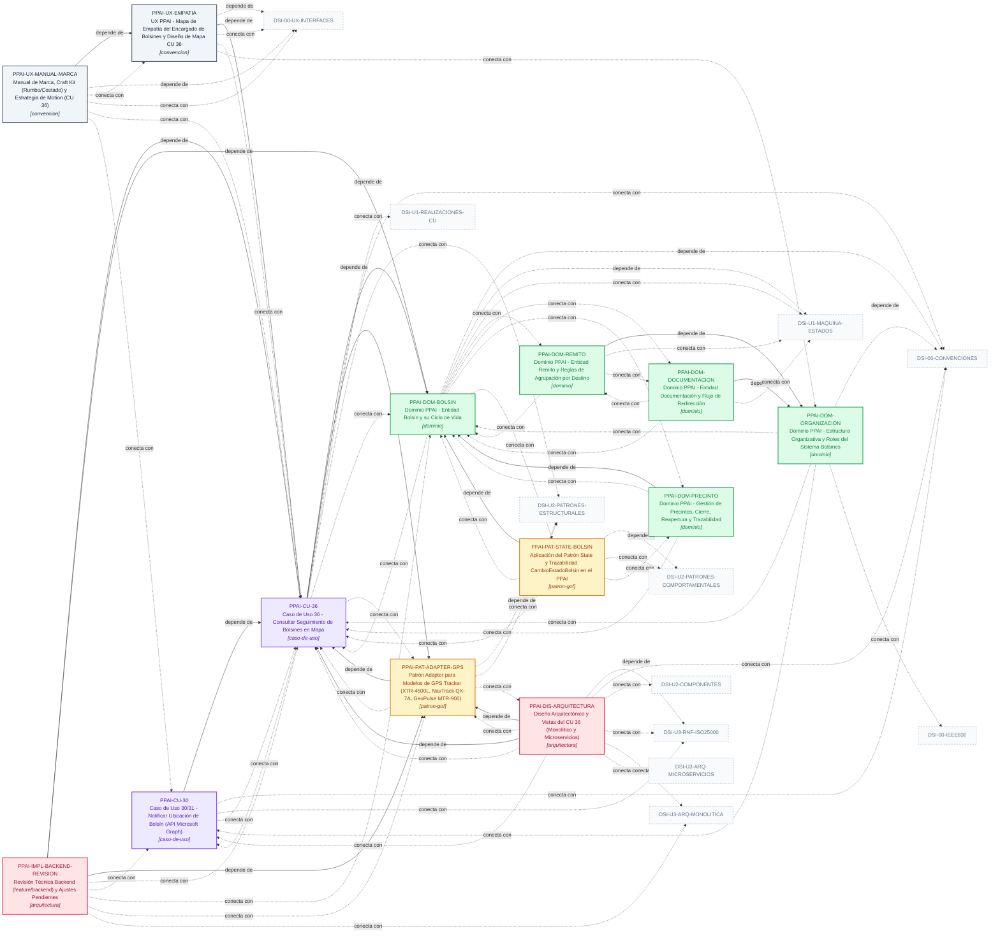
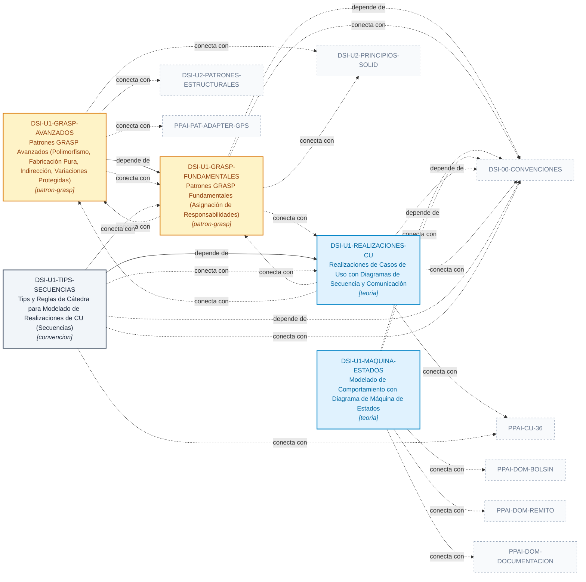
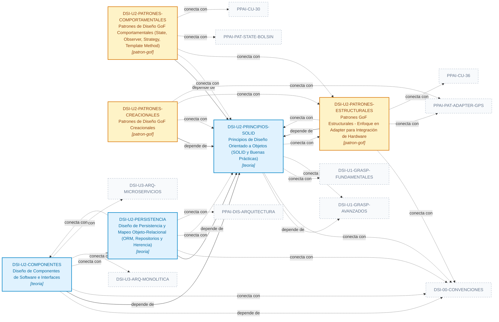
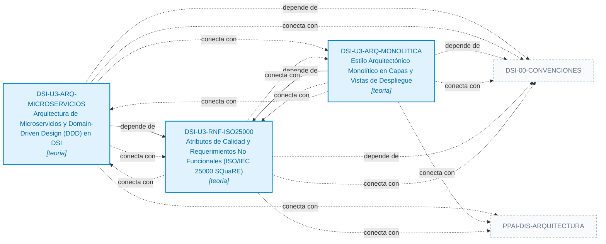

# Segundo Cerebro - Diseño de Sistemas de Información (DSI)

Repositorio de conocimiento estructurado de **Diseño de Sistemas de Información (UTN - FRC)** y del **Proyecto Práctico de Aplicación Integrador (PPAI) - Sistema de Bolsines (CU 36 + CU 30/31)**.

## Métricas del Grafo de Conocimiento
- **Nodos Indexados:** 31
- **Aristas Válidas:** 169
- **Componentes Conexos:** 1
- **Densidad del Grafo:** 0.1817
- **Nodos Centrales (Hubs):** `DSI-00-CONVENCIONES` (34), `PPAI-CU-36` (28), `PPAI-DOM-BOLSIN` (20), `PPAI-DIS-ARQUITECTURA` (17), `DSI-U2-PRINCIPIOS-SOLID` (16)
- **Enlaces Rotos:** 0

## Repositorios de Fuentes Extraídas
- [Fuentes de NotebookLM (Cuaderno DSI)](fuentes_notebooklm/README.md)
- [Fuentes Locales de OneDrive (UTN-FRC)](fuentes_onedrive/README.md)

## Grafo del PPAI Bolsines (Dominio + CU 36 + Patrones + Arquitectura)


## Grafo Teórico por Unidades
### Unidad 1: Análisis OO y Comportamiento


### Unidad 2: Diseño OO, SOLID, Patrones GoF y Persistencia


### Unidad 3: Arquitectura de Software, Estilos e ISO 25000


## Grafo Global Completo
```mermaid
flowchart TD
    classDef teoria fill:#e0f2fe,stroke:#0284c7,stroke-width:2px,color:#0369a1;
    classDef patron fill:#fef3c7,stroke:#d97706,stroke-width:2px,color:#92400e;
    classDef dominio fill:#dcfce7,stroke:#16a34a,stroke-width:2px,color:#15803d;
    classDef cu fill:#ede9fe,stroke:#7c3aed,stroke-width:2px,color:#5b21b6;
    classDef arq fill:#ffe4e6,stroke:#e11d48,stroke-width:2px,color:#9f1239;
    classDef conv fill:#f1f5f9,stroke:#475569,stroke-width:2px,color:#1e293b;
    classDef external fill:#f8fafc,stroke:#94a3b8,stroke-dasharray: 4 4,color:#64748b;
    node_DSI_00_CONVENCIONES["DSI-00-CONVENCIONES<br/>Convenciones Oficiales de Modelado DSI v1.5<br/><i>[convencion]</i>"]:::conv
    node_DSI_00_IEEE830["DSI-00-IEEE830<br/>Estándar IEEE 830 y Especificación de Requerimientos (ERS)<br/><i>[teoria]</i>"]:::teoria
    node_DSI_00_UX_INTERFACES["DSI-00-UX-INTERFACES<br/>Diseño de Interfaces de Usuario (UX, Nielsen, Shneiderman y Empatía)<br/><i>[teoria]</i>"]:::teoria
    node_DSI_U1_GRASP_AVANZADOS["DSI-U1-GRASP-AVANZADOS<br/>Patrones GRASP Avanzados (Polimorfismo, Fabricación Pura, Indirección, Variaciones Protegidas)<br/><i>[patron-grasp]</i>"]:::patron
    node_DSI_U1_GRASP_FUNDAMENTALES["DSI-U1-GRASP-FUNDAMENTALES<br/>Patrones GRASP Fundamentales (Asignación de Responsabilidades)<br/><i>[patron-grasp]</i>"]:::patron
    node_DSI_U1_MAQUINA_ESTADOS["DSI-U1-MAQUINA-ESTADOS<br/>Modelado de Comportamiento con Diagrama de Máquina de Estados<br/><i>[teoria]</i>"]:::teoria
    node_DSI_U1_REALIZACIONES_CU["DSI-U1-REALIZACIONES-CU<br/>Realizaciones de Casos de Uso con Diagramas de Secuencia y Comunicación<br/><i>[teoria]</i>"]:::teoria
    node_DSI_U1_TIPS_SECUENCIAS["DSI-U1-TIPS-SECUENCIAS<br/>Tips y Reglas de Cátedra para Modelado de Realizaciones de CU (Secuencias)<br/><i>[convencion]</i>"]:::conv
    node_DSI_U2_COMPONENTES["DSI-U2-COMPONENTES<br/>Diseño de Componentes de Software e Interfaces<br/><i>[teoria]</i>"]:::teoria
    node_DSI_U2_PATRONES_COMPORTAMENTALES["DSI-U2-PATRONES-COMPORTAMENTALES<br/>Patrones de Diseño GoF Comportamentales (State, Observer, Strategy, Template Method)<br/><i>[patron-gof]</i>"]:::patron
    node_DSI_U2_PATRONES_CREACIONALES["DSI-U2-PATRONES-CREACIONALES<br/>Patrones de Diseño GoF Creacionales<br/><i>[patron-gof]</i>"]:::patron
    node_DSI_U2_PATRONES_ESTRUCTURALES["DSI-U2-PATRONES-ESTRUCTURALES<br/>Patrones GoF Estructurales - Enfoque en Adapter para Integración de Hardware<br/><i>[patron-gof]</i>"]:::patron
    node_DSI_U2_PERSISTENCIA["DSI-U2-PERSISTENCIA<br/>Diseño de Persistencia y Mapeo Objeto-Relacional (ORM, Repositorios y Herencia)<br/><i>[teoria]</i>"]:::teoria
    node_DSI_U2_PRINCIPIOS_SOLID["DSI-U2-PRINCIPIOS-SOLID<br/>Principios de Diseño Orientado a Objetos (SOLID y Buenas Prácticas)<br/><i>[teoria]</i>"]:::teoria
    node_DSI_U3_ARQ_MICROSERVICIOS["DSI-U3-ARQ-MICROSERVICIOS<br/>Arquitectura de Microservicios y Domain-Driven Design (DDD) en DSI<br/><i>[teoria]</i>"]:::teoria
    node_DSI_U3_ARQ_MONOLITICA["DSI-U3-ARQ-MONOLITICA<br/>Estilo Arquitectónico Monolítico en Capas y Vistas de Despliegue<br/><i>[teoria]</i>"]:::teoria
    node_DSI_U3_RNF_ISO25000["DSI-U3-RNF-ISO25000<br/>Atributos de Calidad y Requerimientos No Funcionales (ISO/IEC 25000 SQuaRE)<br/><i>[teoria]</i>"]:::teoria
    node_PPAI_CASOS_REFERENCIA["PPAI-CASOS-REFERENCIA<br/>Casos Prácticos de Referencia de la Cátedra DSI (Salud Mental, Campos, F1, Reclamos)<br/><i>[referencia]</i>"]:::conv
    node_PPAI_CU_30["PPAI-CU-30<br/>Caso de Uso 30/31 - Notificar Ubicación de Bolsín (API Microsoft Graph)<br/><i>[caso-de-uso]</i>"]:::cu
    node_PPAI_CU_36["PPAI-CU-36<br/>Caso de Uso 36 - Consultar Seguimiento de Bolsines en Mapa<br/><i>[caso-de-uso]</i>"]:::cu
    node_PPAI_DIS_ARQUITECTURA["PPAI-DIS-ARQUITECTURA<br/>Diseño Arquitectónico y Vistas del CU 36 (Monolítico y Microservicios)<br/><i>[arquitectura]</i>"]:::arq
    node_PPAI_DOM_BOLSIN["PPAI-DOM-BOLSIN<br/>Dominio PPAI - Entidad Bolsín y su Ciclo de Vida<br/><i>[dominio]</i>"]:::dominio
    node_PPAI_DOM_DOCUMENTACION["PPAI-DOM-DOCUMENTACION<br/>Dominio PPAI - Entidad Documentación y Flujo de Redirección<br/><i>[dominio]</i>"]:::dominio
    node_PPAI_DOM_ORGANIZACION["PPAI-DOM-ORGANIZACION<br/>Dominio PPAI - Estructura Organizativa y Roles del Sistema Bolsines<br/><i>[dominio]</i>"]:::dominio
    node_PPAI_DOM_PRECINTO["PPAI-DOM-PRECINTO<br/>Dominio PPAI - Gestión de Precintos, Cierre, Reapertura y Trazabilidad<br/><i>[dominio]</i>"]:::dominio
    node_PPAI_DOM_REMITO["PPAI-DOM-REMITO<br/>Dominio PPAI - Entidad Remito y Reglas de Agrupación por Destino<br/><i>[dominio]</i>"]:::dominio
    node_PPAI_IMPL_BACKEND_REVISION["PPAI-IMPL-BACKEND-REVISION<br/>Revisión Técnica Backend (feature/backend) y Ajustes Pendientes<br/><i>[arquitectura]</i>"]:::arq
    node_PPAI_PAT_ADAPTER_GPS["PPAI-PAT-ADAPTER-GPS<br/>Patrón Adapter para Modelos de GPS Tracker (XTR-4500L, NavTrack QX-7A, GeoPulse MTR-900)<br/><i>[patron-gof]</i>"]:::patron
    node_PPAI_PAT_STATE_BOLSIN["PPAI-PAT-STATE-BOLSIN<br/>Aplicación del Patrón State y Trazabilidad CambioEstadoBolsin en el PPAI<br/><i>[patron-gof]</i>"]:::patron
    node_PPAI_UX_EMPATIA["PPAI-UX-EMPATIA<br/>UX PPAI - Mapa de Empatía del Encargado de Bolsines y Diseño de Mapa CU 36<br/><i>[convencion]</i>"]:::conv
    node_PPAI_UX_MANUAL_MARCA["PPAI-UX-MANUAL-MARCA<br/>Manual de Marca, Craft Kit (Rumbo/Costado) y Estrategia de Motion (CU 36)<br/><i>[convencion]</i>"]:::conv
    node_DSI_00_CONVENCIONES -.->|"conecta con"| node_DSI_U1_REALIZACIONES_CU
    node_DSI_00_CONVENCIONES -.->|"conecta con"| node_DSI_U1_MAQUINA_ESTADOS
    node_DSI_00_CONVENCIONES -.->|"conecta con"| node_DSI_U2_COMPONENTES
    node_DSI_00_CONVENCIONES -.->|"conecta con"| node_DSI_U3_ARQ_MONOLITICA
    node_DSI_00_CONVENCIONES -.->|"conecta con"| node_DSI_U3_ARQ_MICROSERVICIOS
    node_DSI_00_IEEE830 -.->|"conecta con"| node_DSI_00_CONVENCIONES
    node_DSI_00_IEEE830 -.->|"conecta con"| node_DSI_U3_RNF_ISO25000
    node_DSI_00_IEEE830 -.->|"conecta con"| node_PPAI_CU_36
    node_DSI_00_IEEE830 -.->|"conecta con"| node_PPAI_DOM_ORGANIZACION
    node_DSI_00_UX_INTERFACES -->|"depende de"| node_DSI_00_CONVENCIONES
    node_DSI_00_UX_INTERFACES -.->|"conecta con"| node_DSI_00_CONVENCIONES
    node_DSI_00_UX_INTERFACES -.->|"conecta con"| node_DSI_U3_RNF_ISO25000
    node_DSI_00_UX_INTERFACES -.->|"conecta con"| node_PPAI_UX_EMPATIA
    node_DSI_00_UX_INTERFACES -.->|"conecta con"| node_PPAI_CU_36
    node_DSI_U1_GRASP_AVANZADOS -->|"depende de"| node_DSI_U1_GRASP_FUNDAMENTALES
    node_DSI_U1_GRASP_AVANZADOS -.->|"conecta con"| node_DSI_U1_GRASP_FUNDAMENTALES
    node_DSI_U1_GRASP_AVANZADOS -.->|"conecta con"| node_DSI_U2_PRINCIPIOS_SOLID
    node_DSI_U1_GRASP_AVANZADOS -.->|"conecta con"| node_DSI_U2_PATRONES_ESTRUCTURALES
    node_DSI_U1_GRASP_AVANZADOS -.->|"conecta con"| node_PPAI_PAT_ADAPTER_GPS
    node_DSI_U1_GRASP_FUNDAMENTALES -->|"depende de"| node_DSI_00_CONVENCIONES
    node_DSI_U1_GRASP_FUNDAMENTALES -.->|"conecta con"| node_DSI_00_CONVENCIONES
    node_DSI_U1_GRASP_FUNDAMENTALES -.->|"conecta con"| node_DSI_U1_REALIZACIONES_CU
    node_DSI_U1_GRASP_FUNDAMENTALES -.->|"conecta con"| node_DSI_U1_GRASP_AVANZADOS
    node_DSI_U1_GRASP_FUNDAMENTALES -.->|"conecta con"| node_DSI_U2_PRINCIPIOS_SOLID
    node_DSI_U1_MAQUINA_ESTADOS -->|"depende de"| node_DSI_00_CONVENCIONES
    node_DSI_U1_MAQUINA_ESTADOS -.->|"conecta con"| node_DSI_00_CONVENCIONES
    node_DSI_U1_MAQUINA_ESTADOS -.->|"conecta con"| node_PPAI_DOM_BOLSIN
    node_DSI_U1_MAQUINA_ESTADOS -.->|"conecta con"| node_PPAI_DOM_REMITO
    node_DSI_U1_MAQUINA_ESTADOS -.->|"conecta con"| node_PPAI_DOM_DOCUMENTACION
    node_DSI_U1_REALIZACIONES_CU -->|"depende de"| node_DSI_00_CONVENCIONES
    node_DSI_U1_REALIZACIONES_CU -.->|"conecta con"| node_DSI_00_CONVENCIONES
    node_DSI_U1_REALIZACIONES_CU -.->|"conecta con"| node_DSI_U1_GRASP_FUNDAMENTALES
    node_DSI_U1_REALIZACIONES_CU -.->|"conecta con"| node_DSI_U1_GRASP_AVANZADOS
    node_DSI_U1_REALIZACIONES_CU -.->|"conecta con"| node_PPAI_CU_36
    node_DSI_U1_TIPS_SECUENCIAS -->|"depende de"| node_DSI_00_CONVENCIONES
    node_DSI_U1_TIPS_SECUENCIAS -->|"depende de"| node_DSI_U1_REALIZACIONES_CU
    node_DSI_U1_TIPS_SECUENCIAS -.->|"conecta con"| node_DSI_00_CONVENCIONES
    node_DSI_U1_TIPS_SECUENCIAS -.->|"conecta con"| node_DSI_U1_REALIZACIONES_CU
    node_DSI_U1_TIPS_SECUENCIAS -.->|"conecta con"| node_DSI_U1_GRASP_FUNDAMENTALES
    node_DSI_U1_TIPS_SECUENCIAS -.->|"conecta con"| node_PPAI_CU_36
    node_DSI_U2_COMPONENTES -->|"depende de"| node_DSI_00_CONVENCIONES
    node_DSI_U2_COMPONENTES -->|"depende de"| node_DSI_U2_PRINCIPIOS_SOLID
    node_DSI_U2_COMPONENTES -.->|"conecta con"| node_DSI_00_CONVENCIONES
    node_DSI_U2_COMPONENTES -.->|"conecta con"| node_DSI_U2_PERSISTENCIA
    node_DSI_U2_COMPONENTES -.->|"conecta con"| node_DSI_U3_ARQ_MONOLITICA
    node_DSI_U2_COMPONENTES -.->|"conecta con"| node_DSI_U3_ARQ_MICROSERVICIOS
    node_DSI_U2_PATRONES_COMPORTAMENTALES -->|"depende de"| node_DSI_U2_PRINCIPIOS_SOLID
    node_DSI_U2_PATRONES_COMPORTAMENTALES -.->|"conecta con"| node_DSI_U2_PRINCIPIOS_SOLID
    node_DSI_U2_PATRONES_COMPORTAMENTALES -.->|"conecta con"| node_DSI_U2_PATRONES_ESTRUCTURALES
    node_DSI_U2_PATRONES_COMPORTAMENTALES -.->|"conecta con"| node_PPAI_PAT_STATE_BOLSIN
    node_DSI_U2_PATRONES_COMPORTAMENTALES -.->|"conecta con"| node_PPAI_CU_30
    node_DSI_U2_PATRONES_CREACIONALES -->|"depende de"| node_DSI_U2_PRINCIPIOS_SOLID
    node_DSI_U2_PATRONES_CREACIONALES -.->|"conecta con"| node_DSI_U2_PRINCIPIOS_SOLID
    node_DSI_U2_PATRONES_CREACIONALES -.->|"conecta con"| node_DSI_U2_PATRONES_ESTRUCTURALES
    node_DSI_U2_PATRONES_CREACIONALES -.->|"conecta con"| node_PPAI_PAT_ADAPTER_GPS
    node_DSI_U2_PATRONES_ESTRUCTURALES -->|"depende de"| node_DSI_U2_PRINCIPIOS_SOLID
    node_DSI_U2_PATRONES_ESTRUCTURALES -.->|"conecta con"| node_DSI_00_CONVENCIONES
    node_DSI_U2_PATRONES_ESTRUCTURALES -.->|"conecta con"| node_DSI_U2_PRINCIPIOS_SOLID
    node_DSI_U2_PATRONES_ESTRUCTURALES -.->|"conecta con"| node_PPAI_PAT_ADAPTER_GPS
    node_DSI_U2_PATRONES_ESTRUCTURALES -.->|"conecta con"| node_PPAI_CU_36
    node_DSI_U2_PERSISTENCIA -->|"depende de"| node_DSI_U2_PRINCIPIOS_SOLID
    node_DSI_U2_PERSISTENCIA -.->|"conecta con"| node_DSI_00_CONVENCIONES
    node_DSI_U2_PERSISTENCIA -.->|"conecta con"| node_DSI_U2_PRINCIPIOS_SOLID
    node_DSI_U2_PERSISTENCIA -.->|"conecta con"| node_DSI_U2_COMPONENTES
    node_DSI_U2_PERSISTENCIA -.->|"conecta con"| node_PPAI_DIS_ARQUITECTURA
    node_DSI_U2_PRINCIPIOS_SOLID -->|"depende de"| node_DSI_U1_GRASP_AVANZADOS
    node_DSI_U2_PRINCIPIOS_SOLID -.->|"conecta con"| node_DSI_00_CONVENCIONES
    node_DSI_U2_PRINCIPIOS_SOLID -.->|"conecta con"| node_DSI_U1_GRASP_FUNDAMENTALES
    node_DSI_U2_PRINCIPIOS_SOLID -.->|"conecta con"| node_DSI_U1_GRASP_AVANZADOS
    node_DSI_U2_PRINCIPIOS_SOLID -.->|"conecta con"| node_DSI_U2_PATRONES_ESTRUCTURALES
    node_DSI_U3_ARQ_MICROSERVICIOS -->|"depende de"| node_DSI_00_CONVENCIONES
    node_DSI_U3_ARQ_MICROSERVICIOS -->|"depende de"| node_DSI_U3_RNF_ISO25000
    node_DSI_U3_ARQ_MICROSERVICIOS -.->|"conecta con"| node_DSI_00_CONVENCIONES
    node_DSI_U3_ARQ_MICROSERVICIOS -.->|"conecta con"| node_DSI_U3_RNF_ISO25000
    node_DSI_U3_ARQ_MICROSERVICIOS -.->|"conecta con"| node_DSI_U3_ARQ_MONOLITICA
    node_DSI_U3_ARQ_MICROSERVICIOS -.->|"conecta con"| node_PPAI_DIS_ARQUITECTURA
    node_DSI_U3_ARQ_MONOLITICA -->|"depende de"| node_DSI_00_CONVENCIONES
    node_DSI_U3_ARQ_MONOLITICA -->|"depende de"| node_DSI_U3_RNF_ISO25000
    node_DSI_U3_ARQ_MONOLITICA -.->|"conecta con"| node_DSI_00_CONVENCIONES
    node_DSI_U3_ARQ_MONOLITICA -.->|"conecta con"| node_DSI_U3_RNF_ISO25000
    node_DSI_U3_ARQ_MONOLITICA -.->|"conecta con"| node_DSI_U3_ARQ_MICROSERVICIOS
    node_DSI_U3_ARQ_MONOLITICA -.->|"conecta con"| node_PPAI_DIS_ARQUITECTURA
    node_DSI_U3_RNF_ISO25000 -->|"depende de"| node_DSI_00_CONVENCIONES
    node_DSI_U3_RNF_ISO25000 -.->|"conecta con"| node_DSI_00_CONVENCIONES
    node_DSI_U3_RNF_ISO25000 -.->|"conecta con"| node_DSI_U3_ARQ_MONOLITICA
    node_DSI_U3_RNF_ISO25000 -.->|"conecta con"| node_DSI_U3_ARQ_MICROSERVICIOS
    node_DSI_U3_RNF_ISO25000 -.->|"conecta con"| node_PPAI_DIS_ARQUITECTURA
    node_PPAI_CASOS_REFERENCIA -->|"depende de"| node_DSI_00_CONVENCIONES
    node_PPAI_CASOS_REFERENCIA -.->|"conecta con"| node_DSI_00_CONVENCIONES
    node_PPAI_CASOS_REFERENCIA -.->|"conecta con"| node_DSI_U3_ARQ_MONOLITICA
    node_PPAI_CASOS_REFERENCIA -.->|"conecta con"| node_DSI_U3_ARQ_MICROSERVICIOS
    node_PPAI_CASOS_REFERENCIA -.->|"conecta con"| node_PPAI_DIS_ARQUITECTURA
    node_PPAI_CU_30 -->|"depende de"| node_PPAI_CU_36
    node_PPAI_CU_30 -.->|"conecta con"| node_DSI_00_CONVENCIONES
    node_PPAI_CU_30 -.->|"conecta con"| node_DSI_U3_RNF_ISO25000
    node_PPAI_CU_30 -.->|"conecta con"| node_PPAI_CU_36
    node_PPAI_CU_36 -->|"depende de"| node_PPAI_DOM_BOLSIN
    node_PPAI_CU_36 -->|"depende de"| node_PPAI_PAT_ADAPTER_GPS
    node_PPAI_CU_36 -.->|"conecta con"| node_DSI_00_CONVENCIONES
    node_PPAI_CU_36 -.->|"conecta con"| node_DSI_U1_REALIZACIONES_CU
    node_PPAI_CU_36 -.->|"conecta con"| node_DSI_U2_PATRONES_ESTRUCTURALES
    node_PPAI_CU_36 -.->|"conecta con"| node_PPAI_DOM_BOLSIN
    node_PPAI_CU_36 -.->|"conecta con"| node_PPAI_PAT_ADAPTER_GPS
    node_PPAI_CU_36 -.->|"conecta con"| node_PPAI_CU_30
    node_PPAI_DIS_ARQUITECTURA -->|"depende de"| node_DSI_U3_RNF_ISO25000
    node_PPAI_DIS_ARQUITECTURA -->|"depende de"| node_PPAI_CU_36
    node_PPAI_DIS_ARQUITECTURA -->|"depende de"| node_PPAI_PAT_ADAPTER_GPS
    node_PPAI_DIS_ARQUITECTURA -.->|"conecta con"| node_DSI_00_CONVENCIONES
    node_PPAI_DIS_ARQUITECTURA -.->|"conecta con"| node_DSI_U2_COMPONENTES
    node_PPAI_DIS_ARQUITECTURA -.->|"conecta con"| node_DSI_U3_RNF_ISO25000
    node_PPAI_DIS_ARQUITECTURA -.->|"conecta con"| node_DSI_U3_ARQ_MONOLITICA
    node_PPAI_DIS_ARQUITECTURA -.->|"conecta con"| node_DSI_U3_ARQ_MICROSERVICIOS
    node_PPAI_DIS_ARQUITECTURA -.->|"conecta con"| node_PPAI_CU_36
    node_PPAI_DIS_ARQUITECTURA -.->|"conecta con"| node_PPAI_PAT_ADAPTER_GPS
    node_PPAI_DIS_ARQUITECTURA -.->|"conecta con"| node_PPAI_CU_30
    node_PPAI_DOM_BOLSIN -->|"depende de"| node_DSI_00_CONVENCIONES
    node_PPAI_DOM_BOLSIN -->|"depende de"| node_DSI_U1_MAQUINA_ESTADOS
    node_PPAI_DOM_BOLSIN -.->|"conecta con"| node_DSI_U1_MAQUINA_ESTADOS
    node_PPAI_DOM_BOLSIN -.->|"conecta con"| node_PPAI_DOM_REMITO
    node_PPAI_DOM_BOLSIN -.->|"conecta con"| node_PPAI_DOM_DOCUMENTACION
    node_PPAI_DOM_BOLSIN -.->|"conecta con"| node_PPAI_DOM_PRECINTO
    node_PPAI_DOM_BOLSIN -.->|"conecta con"| node_PPAI_PAT_STATE_BOLSIN
    node_PPAI_DOM_BOLSIN -.->|"conecta con"| node_PPAI_CU_36
    node_PPAI_DOM_DOCUMENTACION -->|"depende de"| node_PPAI_DOM_ORGANIZACION
    node_PPAI_DOM_DOCUMENTACION -.->|"conecta con"| node_DSI_U1_MAQUINA_ESTADOS
    node_PPAI_DOM_DOCUMENTACION -.->|"conecta con"| node_PPAI_DOM_REMITO
    node_PPAI_DOM_DOCUMENTACION -.->|"conecta con"| node_PPAI_DOM_BOLSIN
    node_PPAI_DOM_ORGANIZACION -->|"depende de"| node_DSI_00_CONVENCIONES
    node_PPAI_DOM_ORGANIZACION -.->|"conecta con"| node_DSI_00_IEEE830
    node_PPAI_DOM_ORGANIZACION -.->|"conecta con"| node_PPAI_DOM_BOLSIN
    node_PPAI_DOM_ORGANIZACION -.->|"conecta con"| node_PPAI_CU_36
    node_PPAI_DOM_ORGANIZACION -.->|"conecta con"| node_PPAI_CU_30
    node_PPAI_DOM_PRECINTO -->|"depende de"| node_PPAI_DOM_BOLSIN
    node_PPAI_DOM_PRECINTO -.->|"conecta con"| node_PPAI_DOM_BOLSIN
    node_PPAI_DOM_PRECINTO -.->|"conecta con"| node_PPAI_CU_36
    node_PPAI_DOM_REMITO -->|"depende de"| node_PPAI_DOM_ORGANIZACION
    node_PPAI_DOM_REMITO -.->|"conecta con"| node_DSI_U1_MAQUINA_ESTADOS
    node_PPAI_DOM_REMITO -.->|"conecta con"| node_PPAI_DOM_BOLSIN
    node_PPAI_DOM_REMITO -.->|"conecta con"| node_PPAI_DOM_DOCUMENTACION
    node_PPAI_IMPL_BACKEND_REVISION -->|"depende de"| node_PPAI_CU_36
    node_PPAI_IMPL_BACKEND_REVISION -->|"depende de"| node_PPAI_DOM_BOLSIN
    node_PPAI_IMPL_BACKEND_REVISION -->|"depende de"| node_PPAI_PAT_ADAPTER_GPS
    node_PPAI_IMPL_BACKEND_REVISION -.->|"conecta con"| node_PPAI_CU_36
    node_PPAI_IMPL_BACKEND_REVISION -.->|"conecta con"| node_PPAI_CU_30
    node_PPAI_IMPL_BACKEND_REVISION -.->|"conecta con"| node_PPAI_DOM_BOLSIN
    node_PPAI_IMPL_BACKEND_REVISION -.->|"conecta con"| node_PPAI_PAT_ADAPTER_GPS
    node_PPAI_IMPL_BACKEND_REVISION -.->|"conecta con"| node_DSI_U3_ARQ_MONOLITICA
    node_PPAI_PAT_ADAPTER_GPS -->|"depende de"| node_DSI_U2_PATRONES_ESTRUCTURALES
    node_PPAI_PAT_ADAPTER_GPS -->|"depende de"| node_PPAI_CU_36
    node_PPAI_PAT_ADAPTER_GPS -.->|"conecta con"| node_DSI_U2_PATRONES_ESTRUCTURALES
    node_PPAI_PAT_ADAPTER_GPS -.->|"conecta con"| node_PPAI_CU_36
    node_PPAI_PAT_ADAPTER_GPS -.->|"conecta con"| node_PPAI_DIS_ARQUITECTURA
    node_PPAI_PAT_STATE_BOLSIN -->|"depende de"| node_DSI_U2_PATRONES_COMPORTAMENTALES
    node_PPAI_PAT_STATE_BOLSIN -->|"depende de"| node_PPAI_DOM_BOLSIN
    node_PPAI_PAT_STATE_BOLSIN -.->|"conecta con"| node_DSI_U2_PATRONES_COMPORTAMENTALES
    node_PPAI_PAT_STATE_BOLSIN -.->|"conecta con"| node_PPAI_DOM_BOLSIN
    node_PPAI_PAT_STATE_BOLSIN -.->|"conecta con"| node_PPAI_DOM_PRECINTO
    node_PPAI_PAT_STATE_BOLSIN -.->|"conecta con"| node_PPAI_CU_36
    node_PPAI_UX_EMPATIA -->|"depende de"| node_DSI_00_UX_INTERFACES
    node_PPAI_UX_EMPATIA -->|"depende de"| node_PPAI_CU_36
    node_PPAI_UX_EMPATIA -.->|"conecta con"| node_DSI_00_UX_INTERFACES
    node_PPAI_UX_EMPATIA -.->|"conecta con"| node_PPAI_CU_36
    node_PPAI_UX_EMPATIA -.->|"conecta con"| node_PPAI_DOM_ORGANIZACION
    node_PPAI_UX_MANUAL_MARCA -->|"depende de"| node_PPAI_UX_EMPATIA
    node_PPAI_UX_MANUAL_MARCA -->|"depende de"| node_DSI_00_UX_INTERFACES
    node_PPAI_UX_MANUAL_MARCA -.->|"conecta con"| node_PPAI_UX_EMPATIA
    node_PPAI_UX_MANUAL_MARCA -.->|"conecta con"| node_DSI_00_UX_INTERFACES
    node_PPAI_UX_MANUAL_MARCA -.->|"conecta con"| node_PPAI_CU_36
    node_PPAI_UX_MANUAL_MARCA -.->|"conecta con"| node_PPAI_CU_30
```

## Índice Completo de Nodos del Cerebro
| ID | Título | Tipo | Unidad / Categoría | Conectado con |
|---|---|---|---|---|
| [DSI-00-CONVENCIONES](nodos/DSI-00-CONVENCIONES.md) | Convenciones Oficiales de Modelado DSI v1.5 | `convencion` | Metodologia | DSI-U1-REALIZACIONES-CU, DSI-U1-MAQUINA-ESTADOS, DSI-U2-COMPONENTES, DSI-U3-ARQ-MONOLITICA, DSI-U3-ARQ-MICROSERVICIOS |
| [DSI-00-IEEE830](nodos/DSI-00-IEEE830.md) | Estándar IEEE 830 y Especificación de Requerimientos (ERS) | `teoria` | Metodologia | DSI-00-CONVENCIONES, DSI-U3-RNF-ISO25000, PPAI-CU-36, PPAI-DOM-ORGANIZACION |
| [DSI-00-UX-INTERFACES](nodos/DSI-00-UX-INTERFACES.md) | Diseño de Interfaces de Usuario (UX, Nielsen, Shneiderman y Empatía) | `teoria` | Metodologia | DSI-00-CONVENCIONES, DSI-U3-RNF-ISO25000, PPAI-UX-EMPATIA, PPAI-CU-36 |
| [DSI-U1-GRASP-AVANZADOS](nodos/DSI-U1-GRASP-AVANZADOS.md) | Patrones GRASP Avanzados (Polimorfismo, Fabricación Pura, Indirección, Variaciones Protegidas) | `patron-grasp` | Unidad 1 | DSI-U1-GRASP-FUNDAMENTALES, DSI-U2-PRINCIPIOS-SOLID, DSI-U2-PATRONES-ESTRUCTURALES, PPAI-PAT-ADAPTER-GPS |
| [DSI-U1-GRASP-FUNDAMENTALES](nodos/DSI-U1-GRASP-FUNDAMENTALES.md) | Patrones GRASP Fundamentales (Asignación de Responsabilidades) | `patron-grasp` | Unidad 1 | DSI-00-CONVENCIONES, DSI-U1-REALIZACIONES-CU, DSI-U1-GRASP-AVANZADOS, DSI-U2-PRINCIPIOS-SOLID |
| [DSI-U1-MAQUINA-ESTADOS](nodos/DSI-U1-MAQUINA-ESTADOS.md) | Modelado de Comportamiento con Diagrama de Máquina de Estados | `teoria` | Unidad 1 | DSI-00-CONVENCIONES, PPAI-DOM-BOLSIN, PPAI-DOM-REMITO, PPAI-DOM-DOCUMENTACION |
| [DSI-U1-REALIZACIONES-CU](nodos/DSI-U1-REALIZACIONES-CU.md) | Realizaciones de Casos de Uso con Diagramas de Secuencia y Comunicación | `teoria` | Unidad 1 | DSI-00-CONVENCIONES, DSI-U1-GRASP-FUNDAMENTALES, DSI-U1-GRASP-AVANZADOS, PPAI-CU-36 |
| [DSI-U1-TIPS-SECUENCIAS](nodos/DSI-U1-TIPS-SECUENCIAS.md) | Tips y Reglas de Cátedra para Modelado de Realizaciones de CU (Secuencias) | `convencion` | Unidad 1 | DSI-00-CONVENCIONES, DSI-U1-REALIZACIONES-CU, DSI-U1-GRASP-FUNDAMENTALES, PPAI-CU-36 |
| [DSI-U2-COMPONENTES](nodos/DSI-U2-COMPONENTES.md) | Diseño de Componentes de Software e Interfaces | `teoria` | Unidad 2 | DSI-00-CONVENCIONES, DSI-U2-PERSISTENCIA, DSI-U3-ARQ-MONOLITICA, DSI-U3-ARQ-MICROSERVICIOS |
| [DSI-U2-PATRONES-COMPORTAMENTALES](nodos/DSI-U2-PATRONES-COMPORTAMENTALES.md) | Patrones de Diseño GoF Comportamentales (State, Observer, Strategy, Template Method) | `patron-gof` | Unidad 2 | DSI-U2-PRINCIPIOS-SOLID, DSI-U2-PATRONES-ESTRUCTURALES, PPAI-PAT-STATE-BOLSIN, PPAI-CU-30 |
| [DSI-U2-PATRONES-CREACIONALES](nodos/DSI-U2-PATRONES-CREACIONALES.md) | Patrones de Diseño GoF Creacionales | `patron-gof` | Unidad 2 | DSI-U2-PRINCIPIOS-SOLID, DSI-U2-PATRONES-ESTRUCTURALES, PPAI-PAT-ADAPTER-GPS |
| [DSI-U2-PATRONES-ESTRUCTURALES](nodos/DSI-U2-PATRONES-ESTRUCTURALES.md) | Patrones GoF Estructurales - Enfoque en Adapter para Integración de Hardware | `patron-gof` | Unidad 2 | DSI-00-CONVENCIONES, DSI-U2-PRINCIPIOS-SOLID, PPAI-PAT-ADAPTER-GPS, PPAI-CU-36 |
| [DSI-U2-PERSISTENCIA](nodos/DSI-U2-PERSISTENCIA.md) | Diseño de Persistencia y Mapeo Objeto-Relacional (ORM, Repositorios y Herencia) | `teoria` | Unidad 2 | DSI-00-CONVENCIONES, DSI-U2-PRINCIPIOS-SOLID, DSI-U2-COMPONENTES, PPAI-DIS-ARQUITECTURA |
| [DSI-U2-PRINCIPIOS-SOLID](nodos/DSI-U2-PRINCIPIOS-SOLID.md) | Principios de Diseño Orientado a Objetos (SOLID y Buenas Prácticas) | `teoria` | Unidad 2 | DSI-00-CONVENCIONES, DSI-U1-GRASP-FUNDAMENTALES, DSI-U1-GRASP-AVANZADOS, DSI-U2-PATRONES-ESTRUCTURALES |
| [DSI-U3-ARQ-MICROSERVICIOS](nodos/DSI-U3-ARQ-MICROSERVICIOS.md) | Arquitectura de Microservicios y Domain-Driven Design (DDD) en DSI | `teoria` | Unidad 3 | DSI-00-CONVENCIONES, DSI-U3-RNF-ISO25000, DSI-U3-ARQ-MONOLITICA, PPAI-DIS-ARQUITECTURA |
| [DSI-U3-ARQ-MONOLITICA](nodos/DSI-U3-ARQ-MONOLITICA.md) | Estilo Arquitectónico Monolítico en Capas y Vistas de Despliegue | `teoria` | Unidad 3 | DSI-00-CONVENCIONES, DSI-U3-RNF-ISO25000, DSI-U3-ARQ-MICROSERVICIOS, PPAI-DIS-ARQUITECTURA |
| [DSI-U3-RNF-ISO25000](nodos/DSI-U3-RNF-ISO25000.md) | Atributos de Calidad y Requerimientos No Funcionales (ISO/IEC 25000 SQuaRE) | `teoria` | Unidad 3 | DSI-00-CONVENCIONES, DSI-U3-ARQ-MONOLITICA, DSI-U3-ARQ-MICROSERVICIOS, PPAI-DIS-ARQUITECTURA |
| [PPAI-CASOS-REFERENCIA](nodos/PPAI-CASOS-REFERENCIA.md) | Casos Prácticos de Referencia de la Cátedra DSI (Salud Mental, Campos, F1, Reclamos) | `referencia` | Metodologia | DSI-00-CONVENCIONES, DSI-U3-ARQ-MONOLITICA, DSI-U3-ARQ-MICROSERVICIOS, PPAI-DIS-ARQUITECTURA |
| [PPAI-CU-30](nodos/PPAI-CU-30.md) | Caso de Uso 30/31 - Notificar Ubicación de Bolsín (API Microsoft Graph) | `caso-de-uso` | PPAI | DSI-00-CONVENCIONES, DSI-U3-RNF-ISO25000, PPAI-CU-36 |
| [PPAI-CU-36](nodos/PPAI-CU-36.md) | Caso de Uso 36 - Consultar Seguimiento de Bolsines en Mapa | `caso-de-uso` | PPAI | DSI-00-CONVENCIONES, DSI-U1-REALIZACIONES-CU, DSI-U2-PATRONES-ESTRUCTURALES, PPAI-DOM-BOLSIN, PPAI-PAT-ADAPTER-GPS, PPAI-CU-30 |
| [PPAI-DIS-ARQUITECTURA](nodos/PPAI-DIS-ARQUITECTURA.md) | Diseño Arquitectónico y Vistas del CU 36 (Monolítico y Microservicios) | `arquitectura` | PPAI | DSI-00-CONVENCIONES, DSI-U2-COMPONENTES, DSI-U3-RNF-ISO25000, DSI-U3-ARQ-MONOLITICA, DSI-U3-ARQ-MICROSERVICIOS, PPAI-CU-36, PPAI-PAT-ADAPTER-GPS, PPAI-CU-30 |
| [PPAI-DOM-BOLSIN](nodos/PPAI-DOM-BOLSIN.md) | Dominio PPAI - Entidad Bolsín y su Ciclo de Vida | `dominio` | PPAI | DSI-U1-MAQUINA-ESTADOS, PPAI-DOM-REMITO, PPAI-DOM-DOCUMENTACION, PPAI-DOM-PRECINTO, PPAI-PAT-STATE-BOLSIN, PPAI-CU-36 |
| [PPAI-DOM-DOCUMENTACION](nodos/PPAI-DOM-DOCUMENTACION.md) | Dominio PPAI - Entidad Documentación y Flujo de Redirección | `dominio` | PPAI | DSI-U1-MAQUINA-ESTADOS, PPAI-DOM-REMITO, PPAI-DOM-BOLSIN |
| [PPAI-DOM-ORGANIZACION](nodos/PPAI-DOM-ORGANIZACION.md) | Dominio PPAI - Estructura Organizativa y Roles del Sistema Bolsines | `dominio` | PPAI | DSI-00-IEEE830, PPAI-DOM-BOLSIN, PPAI-CU-36, PPAI-CU-30 |
| [PPAI-DOM-PRECINTO](nodos/PPAI-DOM-PRECINTO.md) | Dominio PPAI - Gestión de Precintos, Cierre, Reapertura y Trazabilidad | `dominio` | PPAI | PPAI-DOM-BOLSIN, PPAI-CU-36 |
| [PPAI-DOM-REMITO](nodos/PPAI-DOM-REMITO.md) | Dominio PPAI - Entidad Remito y Reglas de Agrupación por Destino | `dominio` | PPAI | DSI-U1-MAQUINA-ESTADOS, PPAI-DOM-BOLSIN, PPAI-DOM-DOCUMENTACION |
| [PPAI-IMPL-BACKEND-REVISION](nodos/PPAI-IMPL-BACKEND-REVISION.md) | Revisión Técnica Backend (feature/backend) y Ajustes Pendientes | `arquitectura` | PPAI | PPAI-CU-36, PPAI-CU-30, PPAI-DOM-BOLSIN, PPAI-PAT-ADAPTER-GPS, DSI-U3-ARQ-MONOLITICA |
| [PPAI-PAT-ADAPTER-GPS](nodos/PPAI-PAT-ADAPTER-GPS.md) | Patrón Adapter para Modelos de GPS Tracker (XTR-4500L, NavTrack QX-7A, GeoPulse MTR-900) | `patron-gof` | PPAI | DSI-U2-PATRONES-ESTRUCTURALES, PPAI-CU-36, PPAI-DIS-ARQUITECTURA |
| [PPAI-PAT-STATE-BOLSIN](nodos/PPAI-PAT-STATE-BOLSIN.md) | Aplicación del Patrón State y Trazabilidad CambioEstadoBolsin en el PPAI | `patron-gof` | PPAI | DSI-U2-PATRONES-COMPORTAMENTALES, PPAI-DOM-BOLSIN, PPAI-DOM-PRECINTO, PPAI-CU-36 |
| [PPAI-UX-EMPATIA](nodos/PPAI-UX-EMPATIA.md) | UX PPAI - Mapa de Empatía del Encargado de Bolsines y Diseño de Mapa CU 36 | `convencion` | PPAI | DSI-00-UX-INTERFACES, PPAI-CU-36, PPAI-DOM-ORGANIZACION |
| [PPAI-UX-MANUAL-MARCA](nodos/PPAI-UX-MANUAL-MARCA.md) | Manual de Marca, Craft Kit (Rumbo/Costado) y Estrategia de Motion (CU 36) | `convencion` | PPAI | PPAI-UX-EMPATIA, DSI-00-UX-INTERFACES, PPAI-CU-36, PPAI-CU-30 |
