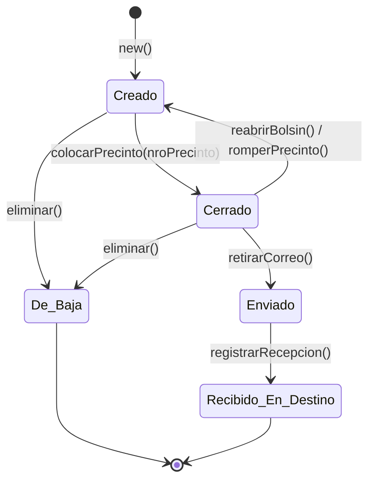

# Modelado de Comportamiento con Diagrama de Máquina de Estados

El diagrama de máquina de estados de UML describe los posibles estados por los que atraviesa una instancia de una clase a lo largo de su ciclo de vida en respuesta a eventos discretos, junto con sus transiciones y acciones asociadas.

## 1. Elementos Fundamentales

1. **Estado (`State`)**: Condición o situación en la vida de un objeto durante la cual satisface alguna condición, realiza alguna actividad o espera algún evento.
   - *Partes internas*:
     - `entry / acción`: Acción ejecutada inmediatamente al ingresar al estado.
     - `exit / acción`: Acción ejecutada justo antes de abandonar el estado.
     - `do / actividad`: Tarea continua o prolongada que se ejecuta mientras el objeto permanece en el estado.
2. **Pseudoestado Inicial**: Círculo negro lleno (`●`), marca el punto de inicio de la máquina al crearse el objeto.
3. **Estado Final**: Círculo negro con borde concéntrico (`◉`), indica la destrucción lógica o física de la entidad (o estado terminal como `De baja`).
4. **Transición**: Flecha dirigida que une dos estados:
   $$\text{Sintaxis Formal: } \text{Evento}(\text{parámetros}) \; [\text{Guard}] \; / \; \text{Acción}$$
   - **Evento**: Detonador o estímulo externo que provoca la evaluación de la transición.
   - **Guarda (`[Guard]`)**: Expresión booleana evaluada al ocurrir el evento. La transición solo se dispara si la guarda es verdadera (`true`).
   - **Acción (`/ Acción`)**: Comportamiento atómico e instantáneo que se ejecuta durante la transición.

---

## 2. Jerarquía y Estados Compuestos

- **Estado Compuesto / Anidado**: Estado que contiene una sub-máquina de estados interna. Permite modularizar ciclos de vida complejos.
  - Subestados secuenciales (o-exclusivos).
  - Subestados concurrentes (regiones ortogonales separadas por línea punteada).

---

## 3. Aplicación en el Dominio del PPAI Bolsines

En el PPAI 2026, tres entidades centrales tienen máquinas de estados interdependientes:
1. `Bolsin`:
   - `[Inicial] --> Creado`
   - `Creado --> Cerrado` (Evento: `cerrarBolsin()`, requiere colocar precinto)
   - `Cerrado --> Enviado` (Evento: `retirarBolsin()`, por el correo)
   - `Enviado --> Recibido en CM destino` (Evento: `recibirBolsin()`)
   - `Creado / Cerrado --> De baja` (Evento: `eliminarBolsin()`)
2. `Remito`:
   - `Creado --> En bolsín saliente --> En bolsín enviado --> Recibido y aceptado / Recibido y aceptado parcial`
3. `Documentacion`:
   - `Registrada --> En remito --> En bolsín saliente --> En bolsín enviado --> Recibida y aceptada / Recibida y rechazada / No recibida / Para redirigir`

