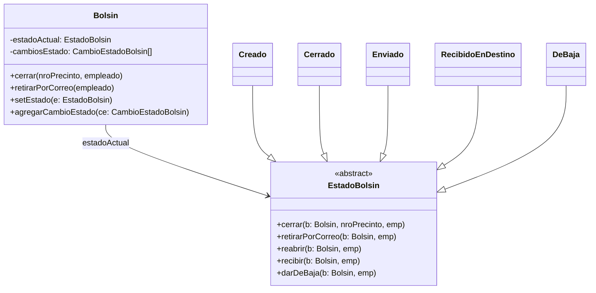

# Patrones GoF Comportamentales y Plantillas de Cátedra DSI

Los patrones comportamentales se ocupan de los algoritmos y la asignación de responsabilidades entre objetos, encapsulando lo que varía (estados, estrategias, notificaciones).

---

## 1. Patrón State (Estado)

### 1.1 Propósito y Problema que Resuelve
Permite a un objeto (**Contexto**) alterar su comportamiento cuando su estado interno cambia. Elimina bloques gigantescos de `if/else` o `switch` dependientes del estado, encapsula las transiciones válidas y garantiza **SRP** y **OCP**.

### 1.2 Participantes
1. **Contexto** (ej. `Bolsin`, `OrdenTraslado`): Mantiene una referencia `estadoActual` de tipo abstracto, expone los métodos de enganche de negocio y delega en `estadoActual.metodo(this)`. Posee `setEstado(nuevoEstado)`.
2. **Estado Abstracto** (ej. `EstadoBolsin`): Clase abstracta o interfaz con los métodos polimórficos de transición que reciben al Contexto por parámetro.
3. **Estados Concretos** (ej. `Creado`, `Cerrado`, `Enviado`, `Recibido`, `DeBaja`): Sobrescriben únicamente los métodos permitidos en ese estado; los inválidos lanzan excepción o retornan error.

### 1.3 Vista Dinámica Estándar (7 Pasos con Trazabilidad `CambioEstado`)
En los parciales y PPAI de DSI, cuando existe historial de cambios de estado (`CambioEstadoBolsin`), la realización de una transición sigue exactamente estos 7 pasos:
1. **Método de enganche**: El `Gestor` invoca `entidad.accion()` sobre el Contexto.
2. **Delegación polimórfica**: El Contexto delega llamando a `estadoActual.accion(this)` pasándose a sí mismo.
3. **Cierre del historial activo**: El Estado Concreto actual recupera el último `CambioEstado` y ejecuta `ultimoCE.setFechaHoraFin(fechaActual)`.
4. **Creación/obtención del estado destino**: El Estado Concreto actual instancia `nuevoEstado = new NuevoEstadoConcreto()`.
5. **Creación del nuevo historial**: Instancia `nuevoCE = new CambioEstado(fechaInicio, nuevoEstado, responsable)`.
6. **Asociación al contexto**: Invoca `contexto.agregarCambioEstado(nuevoCE)`.
7. **Actualización del puntero de estado**: Invoca `contexto.setEstado(nuevoEstado)`.

---

## 2. Patrón Observer (Publicador-Suscriptor)

### 2.1 Propósito y Variantes
Define una dependencia uno-a-muchos entre un **Sujeto** y múltiples **Observadores** de modo que cuando el sujeto cambia o dispara un evento, notifica automáticamente a todos los suscriptores sin acoplarse a sus clases concretas.

- **Modelo Push (Preferido en DSI para notificaciones externas)**: El Sujeto envía en la firma de `actualizar(datos..., contacto)` toda la información que necesitan los canales (ej. `InterfazMail`, `InterfazSMS`, `InterfazWhatsApp`), evitando callbacks al sujeto.
- **Modelo Pull**: El Sujeto pasa una referencia `this` y cada observador consulta los getters que necesita.

### 2.2 Plantilla de Justificación de Parcial (3 Bloques Obligatorios)
1. **Sujeto Concreto (`Gestor...`)**: Declarar que implementa `ISujeto...`, explicar cómo crea los observadores y los agrega con `suscribir(obs: IObservador)`, y cómo su método `notificar()` dispara las notificaciones con los datos recopilados.
2. **Observador Abstracto (`IObservador...`)**: Declarar que es una interfaz sin código cuyo método `actualizar(...)` es **polimórfico**, detallando explícitamente qué parámetros llevan el contenido del mensaje y cuáles los datos de contacto (Modelo Push).
3. **Observadores Concretos (`InterfazMail`, etc.)**: Explicar que implementan `IObservador...` y dentro del método polimórfico invocan su método particular propio (ej. `enviarMail()`, `enviarSMS()`).

---

## 3. Patrón Strategy (Estrategia)
- **Intención**: Definir una familia de algoritmos, encapsular cada uno en una clase independiente con una interfaz común (`IEstrategia...`) y hacerlos intercambiables dinámicamente en tiempo de ejecución.
- **Diferencia con State**: En *Strategy* el cliente/gestor elige y asigna qué estrategia usar según una regla externa o parámetro (ej. cálculo de tarifa, política de filtrado, método de exportación); en *State* los estados se conocen y transicionan autónomamente siguiendo una máquina de estados.

---

## 4. Patrón Template Method (Método Plantilla)
- **Intención**: Definir el esqueleto de un algoritmo en una operación de una clase base abstracta, delegando ciertos pasos variables (`pasoHook()`) a las subclases sin cambiar la estructura general del algoritmo.

---

## 5. Patrón Command & Patrón Iterator
- **Command**: Encapsular una solicitud como un objeto (útil para colas de ejecución, auditoría y soporte de Undo/Deshacer requerido por las reglas de Shneiderman).
- **Iterator**: Proveer una forma secuencial de recorrer elementos de una colección agregada sin exponer su representación interna subyacente.
