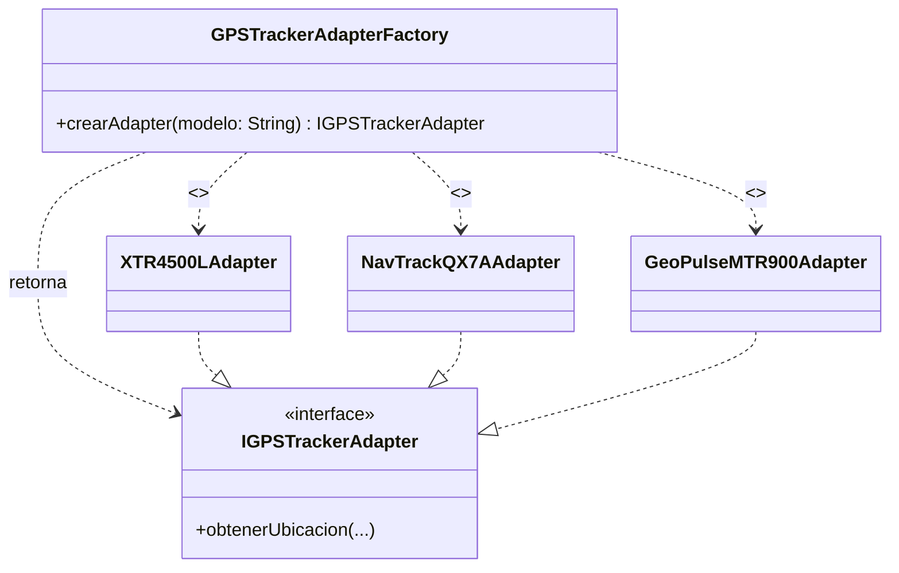

# Patrones de Diseño GoF Creacionales

Los patrones creacionales abstraen el proceso de instanciación de objetos, haciendo al sistema independiente de cómo se crean, componen y representan sus productos concretos.

## 1. Factory Method (Método de Fabricación)
- **Intención**: Definir una interfaz para crear un objeto, pero dejando que las subclases o una factoría especializada decidan qué clase concreta instanciar.
- **Problema que resuelve**: Evita acoplar al cliente (`GestorSeguimientoBolsines`) con las clases concretas mediante operadores `new ClaseConcreta()` dispersos.
- **Principios**: OCP (agregar un nuevo producto sin tocar el cliente) y DIP (depender de la interfaz del producto).
- **Aplicación en el PPAI Bolsines**:
  - `GPSTrackerAdapterFactory.crearAdapter(modeloGPS)` instancia dinámicamente `XTR4500LAdapter`, `NavTrackQX7AAdapter` o `GeoPulseMTR900Adapter` devolviendo siempre la abstracción `IGPSTrackerAdapter`.

---

## 2. Abstract Factory (Fábrica Abstracta)
- **Intención**: Proveer una interfaz para crear **familias de objetos relacionados o dependientes** sin especificar sus clases concretas.
- **Cuándo usarlo en DSI**: Cuando el sistema debe soportar múltiples plataformas, proveedores o temas completos (ej. familia de conectores Cloud AWS vs Azure, o familia de componentes UI Web vs Mobile).

---

## 3. Singleton
- **Intención**: Garantizar que una clase tenga **una única instancia** y proporcionar un punto de acceso global a ella.
- **Estructura**: Constructor privado, atributo estático `instancia`, método estático `getInstance()`.
- **Precaución en DSI**: Usar con moderación (ej. `GestorConfiguracion`, `PoolConexiones`, `SesionActual` en cliente único) para no introducir estado global oculto que dificulte las pruebas unitarias o viole SRP.

---

## 4. Builder (Constructor)
- **Intención**: Separar la construcción de un objeto complejo de su representación, permitiendo crear distintas representaciones con el mismo proceso de construcción paso a paso.
- **Cuándo usarlo en DSI**: Construcción de reportes complejos, consultas con múltiples filtros opcionales o armados de notificaciones ricas HTML con adjuntos para Microsoft Graph.

---

## 5. Prototype
- **Intención**: Especificar los tipos de objetos a crear por medio de una instancia prototípica y crear nuevos objetos copiando (clonando) este prototipo.
