# Patrones GoF Estructurales: Patrón Adapter

Los patrones estructurales describen cómo ensamblar objetos y clases en estructuras más grandes, manteniendo la flexibilidad y la eficiencia.

## 1. El Patrón Adapter (Adaptador / Wrapper)

### 1.1 Propósito
Convertir la interfaz de una clase en otra interfaz que los clientes esperan. Permite que clases con interfaces incompatibles colaboren entre sí.

### 1.2 Participantes
1. **Target (Objetivo / Interfaz Requerida)**: Define la interfaz específica del dominio que el cliente utiliza. En nuestro caso: `IGPSTrackerAdapter`.
2. **Client (Cliente)**: Colabora con objetos que conforman la interfaz Target. En nuestro caso: `GestorSeguimientoBolsines`.
3. **Adaptee (Adaptable / Servicio Externo)**: Define una interfaz existente incompatible que necesita ser adaptada. En nuestro caso:
   - `XTR4500LService` (método `getBolsinLocation()`).
   - `NavTrackQX7AService` (método `retrieveTrackingData()`).
   - `GeoPulseMTR900Service` (método `fetchCargoPositions()`).
4. **Adapter (Adaptador)**: Adapta la interfaz de Adaptee a la interfaz Target implementando Target y manteniendo una referencia a Adaptee (Adapter de Objetos).

```mermaid
classDiagram
    class Cliente_Gestor {
        +consultarSeguimientoBolsines()
    }

    class IGPSTrackerAdapter {
        <<interface>>
        +obtenerUbicacion(nroBolsin, cmOrigen, cmDestino) UbicacionNormalizada
    }

    class XTR4500LAdapter {
        -adaptee: XTR4500LService
        +obtenerUbicacion(nroBolsin, cmOrigen, cmDestino) UbicacionNormalizada
    }

    class NavTrackQX7AAdapter {
        -adaptee: NavTrackQX7AService
        +obtenerUbicacion(nroBolsin, cmOrigen, cmDestino) UbicacionNormalizada
    }

    class GeoPulseMTR900Adapter {
        -adaptee: GeoPulseMTR900Service
        +obtenerUbicacion(nroBolsin, cmOrigen, cmDestino) UbicacionNormalizada
    }

    class XTR4500LService {
        +getBolsinLocation(apiKey, nroBolsin, codCMOrigen) String JSON
    }

    class NavTrackQX7AService {
        +retrieveTrackingData(apiKey, nroBolsin, codCMDestino) String CSV
    }

    class GeoPulseMTR900Service {
        +fetchCargoPositions(apiKey, nroBolsin) Array2D
    }

    Cliente_Gestor ..> IGPSTrackerAdapter : usa
    XTR4500LAdapter ..|> IGPSTrackerAdapter : implementa
    NavTrackQX7AAdapter ..|> IGPSTrackerAdapter : implementa
    GeoPulseMTR900Adapter ..|> IGPSTrackerAdapter : implementa

    XTR4500LAdapter --> XTR4500LService : delega
    NavTrackQX7AAdapter --> NavTrackQX7AService : delega
    GeoPulseMTR900Adapter --> GeoPulseMTR900Service : delega
```

---

## 2. Otros Patrones Estructurales Relevantes
- **Facade (Fachada)**: Proporciona una interfaz unificada y simplificada a un conjunto de interfaces complejas de un subsistema.
- **Decorator (Decorador)**: Añade dinámicamente responsabilidades adicionales a un objeto sin modificar su clase original.
- **Proxy**: Proporciona un sustituto o marcador de posición para controlar el acceso a otro objeto (e.g., Remote Proxy, Virtual Proxy).
