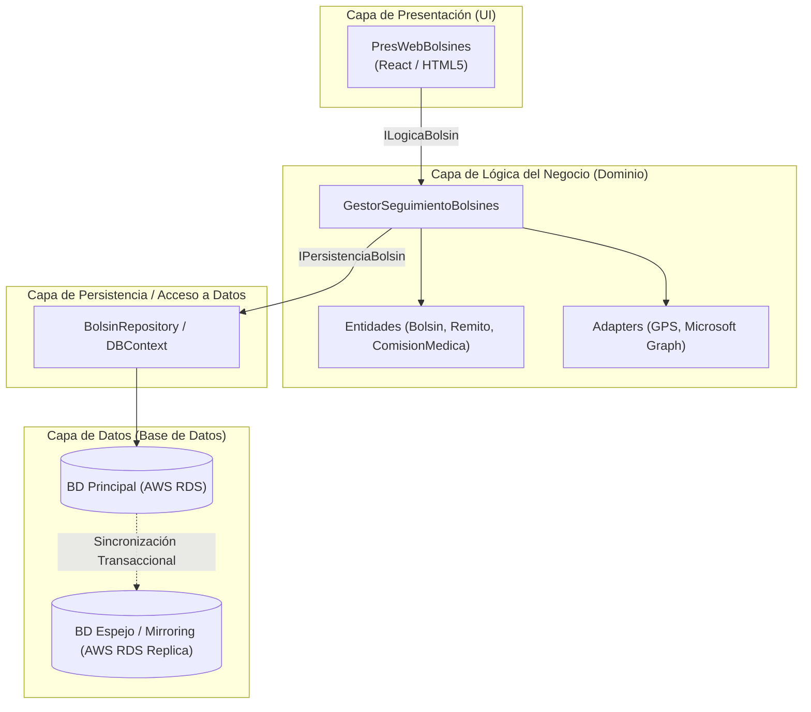

# Estilo Arquitectónico Monolítico en Capas

El estilo monolítico estructura la aplicación como una única unidad ejecutable desacoplada horizontalmente en capas lógicas de responsabilidad.

## 1. Organización en Capas Canónicas de DSI

---

## 2. Convenciones para la Vista de Despliegue con Database Mirroring

Conforme al **RNF 2** y a las convenciones de cátedra DSI v1.5:
- Servidor de Aplicaciones (`<<device>> Servidor de Aplicaciones Web`).
- Servidor de Base de Datos Principal (`<<device>> Servidor BD Principal AWS`).
- Servidor de Base de Datos Espejo (`<<device>> Servidor BD Espejo AWS`).
- Conmutación automática: El servidor de aplicaciones mantiene configurada una cadena de conexión con el parámetro `Failover Partner` hacia la base de datos espejo para garantizar continuidad operativa 24x7x365.
