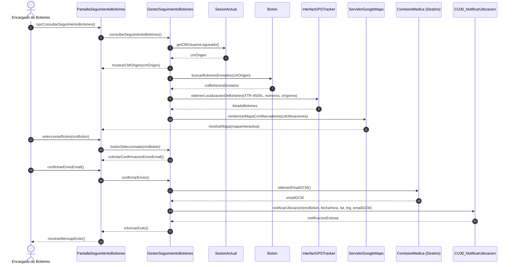
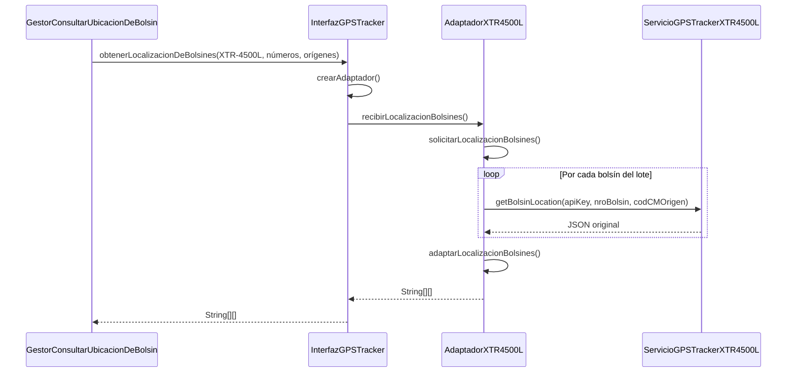

# Caso de Uso 36: Consultar Seguimiento de Bolsines en Mapa

## 1. Ficha Técnica del Caso de Uso

- **Número de Orden**: 36
- **Nombre**: Consultar seguimiento de bolsines
- **Actor Principal**: Encargado de Bolsines (EB)
- **Actores Secundarios**:
  - `GPS Tracker` (Software / Hardware de geolocalización)
  - `Servidor Google Maps` (Software de renderizado de mapas interactivos)
- **Tipo**: Concreto
- **Prioridad**: Alta | **Complejidad**: Mediano
- **Objetivo**: Consultar en un mapa interactivo la ubicación en tiempo real de los bolsines que se encuentran en tránsito (estado `Enviado`) entre comisiones médicas, con posibilidad de notificar por email al Gerente de la Comisión Médica destino.

---

## 2. Flujo Principal (Escenario Feliz)

1. **EB**: Selecciona la opción para consultar la ubicación de uno o varios bolsines.
2. **Sistema**: Busca y muestra la Comisión Médica (CM) del usuario logueado.
3. **Sistema**: Busca todos los bolsines en estado `Enviado` cuya CM origen sea igual a la CM del usuario logueado.
4. **Sistema**: Solicita al dispositivo `GPS Tracker` los datos de localización de cada uno de los bolsines encontrados (mediante el patrón *Adapter*).
5. **Sistema**: Recibe del dispositivo `GPS Tracker` los datos de localización normalizados (latitud, longitud, fecha y hora de última actualización).
6. **Sistema**: Muestra sobre un mapa la posición geográfica de los bolsines, habilitando la opción de seleccionar un bolsín del mapa o filtrar por número de precinto o CM destino.
7. **EB**: Selecciona un bolsín del mapa.
8. **Sistema**: Consulta si se desea enviar un correo electrónico al Gerente de Comisión Médica (GCM) destino para informar la ubicación del Bolsín.
9. **EB**: Confirma el envío del correo electrónico.
10. **Sistema**: Busca la dirección de correo electrónico del GCM destino.
11. **Sistema**: Para informar número de bolsín, fecha/hora de última actualización y coordenadas, invoca al **Caso de Uso 30/31: Notificar ubicación de bolsín**. Informa la ejecución exitosa de la notificación. **Fin del caso de uso.**

---

## 3. Flujos Alternativos

- **A1: No se encuentran bolsines en estado enviado**: El sistema emite un mensaje informando que no existen bolsines despachados en tránsito para la CM actual y finaliza el caso de uso.
- **A2: No se encuentra bolsín con el número de precinto ingresado**: El sistema notifica al EB que el filtro no arrojó resultados y permite restablecer el filtro.
- **A3: El GPS Tracker no pudo informar ubicación del bolsín**: El sistema informa que el dispositivo no responde o está fuera de cobertura y muestra la última posición conocida con una advertencia visual.
- **A4: El EB cancela la ejecución del caso de uso**: El sistema retorna a la pantalla principal.
- **A5: El EB no selecciona la opción para enviar un correo electrónico**: El sistema omite los pasos 9 a 11 y finaliza la consulta manteniendo la visualización en el mapa.

---

## 4. Diagrama de Secuencia de Análisis (Mermaid)

**[NACHO]** La consulta GPS del flujo principal se detalla en el tramo XTR-4500L de la sección siguiente.

## [NACHO] Tramo GPS del CU 36 con CM origen

Este tramo detalla la consulta GPS del diagrama anterior. El gestor reúne los números y códigos de CM origen de los bolsines en estado `Enviado` cuya CM origen coincide con la del usuario logueado. La CM destino del bolsín seleccionado se consulta posteriormente para el correo.

La frontera invoca al adaptador a través de `IAdaptadorLocalizacionBolsines`. El servicio usa `TransporteHTTPGPS` para llegar al simulador. QX-7A y MTR-900 están disponibles en la integración genérica.

### [NACHO] Métodos de dominio y alcance GPS vigente

La decisión vigente contempla los tres modelos en el futuro gestor: XTR usa número y CM origen, QX usa número y CM destino, y MTR usa solo número. El tramo XTR anterior documenta uno de esos recorridos. La búsqueda del gerente para el correo sigue siendo una operación independiente.

### [NACHO] Migración al GPS Tracker oficial

El tramo GPS del CU 36 consulta el servicio oficial `gps-tracker` por HTTP a través de la frontera y los tres adaptadores existentes. El fixture 101 del proveedor usa `CM-CBA-01` como origen y `CM-ROS-02` como destino. El seed local usa los números 36001 a 36035 y sus propios códigos. La prueba de integración inyecta el fixture oficial en la frontera. Queda pendiente preparar datos compatibles en una base aislada para probar el futuro gestor completo.

### [NACHO] Consulta y selección en OpenFreeMap

La pantalla `/seguimiento` consulta `GET /api/auth/cu36/seguimiento`. La sesión aporta el rol Encargado de Bolsines y la CM origen. `GestorConsultarUbicacionDeBolsin` pide al repositorio los bolsines en estado Enviado de esa CM y llama al Adapter XTR para los fixtures del GPS oficial. Distingue sedes por CM local y número, por ejemplo 101 y 110 de Córdoba. Los demás bolsines se contabilizan como enviados sin ubicación.

La vista usa MapLibre con cartografía de OpenFreeMap en lugar del proveedor cartográfico nombrado en el diagrama. Calcula el encuadre inicial con las coordenadas de todo el lote y permite seleccionar un bolsín en el mapa o en la lista. El detalle muestra la última ubicación informada. Quedan pendientes los filtros del escenario completo, la recuperación de la última posición ante fallos del GPS y la notificación al GCM desde la pantalla.

### [NACHO] Pantalla integrada al frontend

La ruta `src/app/(app)/seguimiento/page.tsx` integra el mapa real de la primera pantalla al layout protegido. Comparte la selección entre mapa y listado y conserva la consulta por sesión al gestor del CU 36. El flujo mantiene la integración XTR y la visualización de detalle. Los filtros y la confirmación de notificación se completarán por separado.

### [NACHO] Ciclo de vida de MapLibre

El primer montaje de prueba de Strict Mode se cancela antes de crear MapLibre. La instancia se mantiene al actualizar los puntos; la selección marca el botón existente. Al salir se cancela el cuadro pendiente, se desconecta el observador y se retiran los marcadores antes de llamar a `mapa.remove()`. El listener del mapa descarta únicamente `AbortError` emitidos después de iniciar su limpieza. El resto se registra. Vitest verificó el montaje diferido y la limpieza idempotente con cuadros simulados. El comportamiento con OpenFreeMap en el navegador queda pendiente de verificación.

### [NACHO] Consulta, selección y aviso al GCM

La ruta `/seguimiento` conserva el App Shell. Precinto y código de CM destino filtran el mismo conjunto para el mapa y la lista. La selección se conserva en React y cada solicitud HTTP vuelve a comprobar la sesión y la autorización. Tanto cancelar como elegir «No enviar correo» evitan la operación de confirmación.

| Participante UML | Archivo TypeScript | Operaciones en ejecución |
| --- | --- | --- |
| PantallaConsultarUbicacionDeBolsines | `src/app/api/auth/cu36/seguimiento/PantallaConsultarUbicacionDeBolsines.ts` | `habilitarPantalla`, `opcConsultarUbicacionDeBolsines`, `mostrarCMDeLogueado`, `mostrarPosicionDeBolsines`, `mostrarOpcionesDeSeleccionBolsin`, `tomarSeleccionDeBolsin`, `solicitarOpcEnviarCorreoGCM`, `tomarConfirmacionOpcEnviarCorreoGCM`. Presenta DTOs y delega en un gestor. Los marcadores y el listado materializan las opciones de selección. |
| GestorConsultarUbicacionDeBolsin | `src/services/GestorConsultarUbicacionDeBolsin.ts` | Identifica al empleado y su CM, busca enviados, consulta ubicaciones normalizadas y las asocia con los bolsines, solicita el mapa y valida selección y confirmación. Obtiene CM destino, GCM y email, llama al CU 31 y ejecuta `finCU`. |
| Sesion, Usuario, Empleado, Rol, ComisionMedica | `src/domain/` | `getUsuario`, `esTuUsuario`, `obtenerCM`, `getNombre`, `getDireccion`, `getCodigo`, `esTuCM`, `sosGCM`, `esGCM`, `getEmail`. `SesionService.buscarEmpleadoLogueado` reutiliza la verificación de identidad; el correo pertenece a Empleado. |
| Bolsin, CambioEstadoBolsin, Estado | `src/domain/` | `esCMOrigenIgualCMLogueado`, `buscarEstadoActualBolsin`, `sosActual`, `esAmbitoBolsin`, `esEnviado`, `getNumeroBolsin`, `obtenerCodCMOrigen` y `getCmDestino`. Los repositorios hidratan las asociaciones para que resuelvan estas consultas. |
| InterfazGPSTracker, IAdaptadorLocalizacionBolsines, AdaptadorXTR4500L y ServicioGPSTrackerXTR4500L | `src/externalInterfaces/gpsTracker/`, `src/integrations/gpsTracker/ServicioGPSTrackerXTR4500L.ts` | El gestor usa la frontera con XTR; esta crea el adaptador y recibe la matriz normalizada de la operación existente. El servicio solicita las ubicaciones al GPS oficial. |
| InterfazGoogleMaps y ServidorGoogleMaps | `src/externalInterfaces/maps/InterfazGoogleMaps.ts`, `src/integrations/maps/ServidorGoogleMaps.ts` | `obtenerMapaConPosicionDeBolsines` delega a `getMapaLocation`. Devuelve las posiciones y el estilo OpenFreeMap. `MapaBolsines.tsx` consume ese resultado en el navegador con MapLibre. |
| GestorNotificarUbicacionBolsin | `src/services/GestorNotificarUbicacionBolsin.ts` | `llamarCU31NotificarUbicacionDeBolsin` invoca directamente `notificarUbicacionDeBolsin` con datos recuperados de nuevo del servidor. Se reutiliza `ServicioCorreoSMTP`. |

**Contratos HTTP.** `GET /api/auth/cu36/seguimiento` devuelve CM, mapa y cantidad sin ubicación. `POST /api/auth/cu36/seguimiento/seleccion` valida un `{ bolsinId }` y habilita la oferta de envío. `POST /api/auth/cu36/seguimiento` acepta el mismo cuerpo y revalida el bolsín antes de resolver GCM y GPS. Las solicitudes son independientes. Se devuelven 400 para cuerpo inválido, 401 para sesión inválida, 403 para rol u origen ajeno, 404 para bolsín inexistente, 409 para estado incompatible o GCM faltante/ambiguo y 503 ante caída GPS/SMTP. No se cargan coordenadas ficticias ni se mantiene una caché de última posición.

**Correspondencia entre vistas.** La secuencia muestra el gestor en plural y el diagrama de clases lo nombra en singular; se conserva `GestorConsultarUbicacionDeBolsin`. Para la Boundary prima el nombre plural pedido expresamente. Se usa la ortografía y los nombres de la consigna para `tomarConfirmacionOpcEnviarCorreoGCM` y `solicitarMapaConPosicionDeBolsines`; el diagrama de clases contiene variantes. La secuencia XTR de dos argumentos y la inyección de la clave al recibir no coinciden con el Adapter multiproveedor vigente, cuya firma recibe modelo, números, orígenes y destinos y cuya clave se inyecta al construir el adaptador. Se preservó el Adapter existente hasta que se decida cuál firma debe quedar en UML. Las operaciones que esperan I/O son asíncronas y el mapa se entrega como DTO serializable.

### [NACHO] Adaptación del JSON de XTR

Se retira la operación `procesarJSONConDatosBolsines()` del gestor. En el rediseño, `AdaptadorXTR4500L.adaptarLocalizacionBolsines()` interpreta y valida el JSON de XTR. `solicitarDatosDeLocalizacionDeBolsines()` recibe la matriz normalizada de `InterfazGPSTracker` y asocia las ubicaciones con los datos de cada bolsín para construir el DTO.

### [NACHO] Tecnologías cartográficas del CU 36

El mapa de `/seguimiento` no usa la API ni el SDK de Google Maps. Por la estética elegida para el seguimiento, `MapaBolsines.tsx` renderiza con MapLibre GL JS y carga el estilo **Bright** y los recursos cartográficos de OpenFreeMap. Las coordenadas y su fecha provienen del GPS oficial: `AdaptadorXTR4500L.adaptarLocalizacionBolsines()` interpreta y normaliza la respuesta XTR y el gestor asocia los puntos normalizados con los bolsines.

`InterfazGoogleMaps.obtenerMapaConPosicionDeBolsines()` delega en `ServidorGoogleMaps.getMapaLocation()`, que entrega los puntos y la URL del estilo. Los nombres, las operaciones y la delegación se conservan para demostrar la correspondencia con el UML aprobado. El botón **Ver ubicación en Google Maps** del correo del CU 31 abre una URL pública independiente.

### [NACHO] Renderizado cartográfico del seguimiento en main

`MapaSeguimiento` carga `MapaLibreSeguimiento` solo en el cliente. MapLibre GL JS renderiza los estilos Bright y Dark de OpenFreeMap y usa el worker local en `/maplibre/maplibre-gl-worker.mjs`. Las capas GeoJSON representan las rutas generales y los tramos en modo foco. `MarcadorMapa` monta el marcador React de cada bolsín mediante MapLibre. Ante un fallo de inicialización del mapa, la pantalla permite reintentar y mantiene accesible la lista.

La API GPS de la cátedra sigue proveyendo las ubicaciones. El cálculo de rutas en pantalla consulta OSRM con un trazado local de respaldo. Se retiraron el SDK de mapas de Google y sus variables públicas de la configuración de seguimiento. Las referencias a Google Maps del diseño histórico y los enlaces del correo del CU 31 se conservan. El contrato del CU 36 y el Adapter GPS siguen iguales.

Verificación: Compose resolvió sus servicios y `git diff --check` pasó. La instalación de dependencias quedó bloqueada por resolución DNS del registro npm. Typecheck, lint, tests, build y la comprobación del mapa en el navegador quedan pendientes.

### [NACHO] Reinicio del gestor del CU 36 (2026-11-18)

A pedido del usuario se retiró toda la lógica de `GestorConsultarUbicacionDeBolsin` para reprogramarlo desde cero. Esta sección reemplaza las descripciones anteriores del gestor como funcional: consulta, selección y confirmación están pendientes. Se eliminaron métodos privados, mapeos de fixtures, construcción de DTOs, consultas GPS y delegación al CU 31 dentro del gestor.

Se conservan la clase, el error exportado, los argumentos del constructor y las firmas de los tres métodos públicos para mantener compatibles los consumidores existentes. El constructor no guarda ni utiliza dependencias; el proveedor GPS es opcional y no se instancia. Cada operación rechaza con `ErrorSeguimientoBolsines(503, "Gestor pendiente de implementación.")`, que la Boundary transforma en HTTP 503. No se devuelve una consulta vacía como si hubiera sido exitosa. El Adapter, entidades, repositorios, pantalla y CU 31 independiente siguen en sus archivos existentes.

El UML aprobado se conserva como objetivo de reimplementación; el esqueleto actual no implementa sus responsabilidades ni colaboraciones. Las 12 pruebas anteriores de `tests/seguimiento-bolsines.test.ts` se preservan en una suite `describe.skip` y deben revisarse y reactivarse durante la reimplementación.

Verificación: Vitest con un worker pasó 307 pruebas y omitió 18 (12 del gestor y 6 HTTP GPS). ESLint de los archivos modificados pasó. El typecheck no pudo aprobarse por referencias obsoletas en `.next/dev`, ausencia de `maplibre-gl` y tipos `google` en archivos ajenos al cambio. Pendiente: reimplementar el gestor según UML, reactivar sus pruebas y verificar CU 36 completo con GPS y correo.

### [NACHO] Integración GPS pendiente

Además del gestor, está pendiente el [Adapter GPS](PPAI-PAT-ADAPTER-GPS.md#nacho-reinicio-de-la-implementación-del-adapter-gps-2026-11-18). La frontera conserva la firma de consulta del diseño y rechaza lotes no vacíos mientras se reconstruyen los adaptadores y servicios.

### [NACHO] Ubicación de las integraciones

La tabla de clases anterior describe el flujo de referencia. El servidor cartográfico vive en `src/integrations/maps/ServidorGoogleMaps.ts`. Los servicios GPS del diseño se reimplementarán en `src/integrations/gpsTracker/`. La delegación cartográfica, las firmas y el UML se conservan.

### [NACHO] Mapa con recorridos viales y foco de bolsín

El GET de seguimiento obtiene las ubicaciones del GPS oficial y pasa solo número, latitud, longitud y fecha de actualización a `InterfazGoogleMaps.obtenerMapaConPosicionDeBolsines()`. La frontera delega en `ServidorGoogleMaps.getMapaLocation()`, que busca el lote por número en el repositorio de bolsines y carga sus dos relaciones, `cmOrigen` y `cmDestino`. La búsqueda cartográfica es global y reutilizable. Si el número no existe o identifica a varios bolsines, entrega el punto GPS sin asociar una ficha ni una ruta.

La integración obtiene las coordenadas de las direcciones con Photon (`MAPAS_GEOCODIFICADOR_URL` permite indicar otra instancia compatible). Las sedes ficticias del seed usan las coordenadas de referencia del catálogo. OSRM calcula el trazado vial de origen a destino y se comparte un cálculo por par de sedes en el lote. Si falla una resolución, el DTO conserva el punto GPS y los datos disponibles. El recorrido se representa mediante geometría serializable y los nombres de frontera y servidor se conservan como en el UML.

`MapaSeguimiento` recibe el DTO en el frontend y se ocupa del mapa base OpenFreeMap, los marcadores y recorridos. Al seleccionar un bolsín, destaca la ruta y muestra los marcadores de origen y destino disponibles junto al punto GPS. La ficha muestra número, datos de las comisiones, direcciones y fecha de última actualización en hora argentina. El recorrido previsto puede quedar separado de la última posición reportada.

### [NACHO] Ejecución del CU 36 por el gestor con XTR-4500L

La pantalla delega consulta, selección y confirmación a `GestorConsultarUbicacionDeBolsin`. En consulta, `SesionService` identifica al empleado mediante `Sesion.getUsuario()` y `Empleado.esTuUsuario()`. El gestor exige el rol Encargado, obtiene la comisión del empleado y aplica los métodos de dominio para verificar CM origen y estado Enviado. `obtenerNumerosBolsines()` y `obtenerCMOrigenesBolsines()` recorren el mismo lote en orden. La constante `MODELO_GPS_TRACKER` fija la sobrecarga XTR. Los códigos de los fixtures del seed se traducen a los códigos oficiales del GPS. Un 404 del lote habilita la consulta individual para conservar las ubicaciones disponibles. Un lote vacío omite el GPS.

El gestor entrega a `InterfazGoogleMaps` solo número, latitud, longitud y fecha. El enriquecimiento y el enrutamiento siguen en la integración cartográfica. La respuesta mantiene el mapa serializable para `MapaSeguimiento` y el contador de bolsines sin posición. La asignación de recorridos y el punto GPS real se mantienen como se describen arriba.

La selección valida el bolsín por identificador, origen y estado y presenta la opción de correo. La confirmación revalida el bolsín en su propia solicitud, toma la CM destino con `Bolsin.getCmDestino()`, identifica un único gerente con `esTuCM()` y `sosGCM()`, usa `Empleado.getEmail()` y obtiene la posición vigente mediante XTR. `llamarCU31NotificarUbicacionDeBolsin()` delega en el gestor de notificación existente. Cerrar el diálogo finaliza la interacción sin ejecutar la solicitud de envío. El frontend presenta los errores reales de selección y confirmación por identificador.

La implementación es por solicitud, sin guardar estado compartido entre usuarios o pestañas. La pantalla conserva el método `habilitarPantalla()` y la firma del contrato HTTP. El navegador maneja el foco del mapa, y el POST de selección del backend se ejecuta al abrir la confirmación. `getCmDestino()` conserva la escritura vigente del código para la operación `getCMDestino()` del modelo.

### [NACHO] Sedes oficiales desde init.sql

El seed asigna los códigos de sede oficiales a las asociaciones de origen y destino de los bolsines 101 a 110. El gestor pasa directamente el código de CM origen. El usuario bolsines.demo pertenece a CM-CBA-01 y ve el 101. El 110 pertenece a CM-CBA-02.

### [NACHO] Variante del CU 36 con selección de GPS

La ruta `/seguimiento/con-opcion-a-elegir` reutiliza el workspace, mapa y confirmación. El GET de la variante sin modelo identifica la CM y cuenta los bolsines enviados autorizados antes de habilitar el selector. El GET con modelo vuelve a validar la sesión y el lote, y cada solicitud crea un gestor independiente. La selección del bolsín y la confirmación usan endpoints de la variante. Para confirmar se vuelve a consultar la posición con el modelo elegido y se delega el correo al CU 31 existente.

InterfazGPSTracker selecciona el adaptador concreto. El nuevo gestor pasa CM origen a XTR, CM destino a QX y solo los números a MTR. La normalización queda en los adaptadores. Un 404 de ubicación permite recuperar el resto del lote. El gestor original y los handlers del CU 36 con XTR fijo se conservan.
