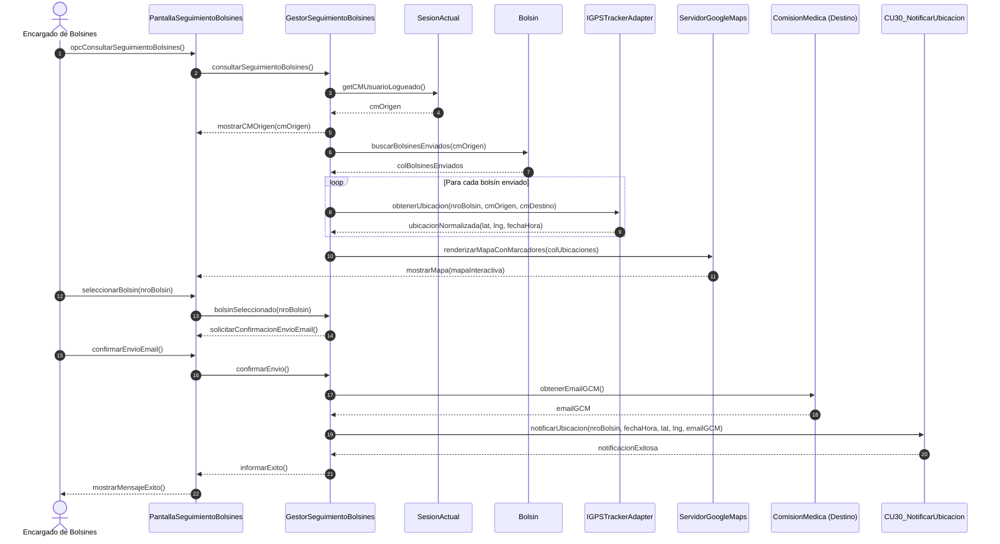

# Caso de Uso 36: Consultar Seguimiento de Bolsines en Mapa

## 1. Ficha Técnica del Caso de Uso

- **Número de Orden**: 36
- **Nombre**: Consultar seguimiento de bolsines
- **Actor Principal**: Encargado de Bolsines (EB)
- **Actores Secundarios**:
  - `GPS Tracker` (Software / Hardware de geolocalización)
  - `Servidor Google Maps` (Software de renderizado de mapas interactivos)
- **Tipo**: Concreto
- **Prioridad**: Alta | **Complejidad**: Mediano
- **Objetivo**: Consultar en un mapa interactivo la ubicación en tiempo real de los bolsines que se encuentran en tránsito (estado `Enviado`) entre comisiones médicas, con posibilidad de notificar por email al Gerente de la Comisión Médica destino.

---

## 2. Flujo Principal (Escenario Feliz)

1. **EB**: Selecciona la opción para consultar la ubicación de uno o varios bolsines.
2. **Sistema**: Busca y muestra la Comisión Médica (CM) del usuario logueado.
3. **Sistema**: Busca todos los bolsines en estado `Enviado` cuya CM origen sea igual a la CM del usuario logueado.
4. **Sistema**: Solicita al dispositivo `GPS Tracker` los datos de localización de cada uno de los bolsines encontrados (mediante el patrón *Adapter*).
5. **Sistema**: Recibe del dispositivo `GPS Tracker` los datos de localización normalizados (latitud, longitud, fecha y hora de última actualización).
6. **Sistema**: Muestra sobre un mapa la posición geográfica de los bolsines, habilitando la opción de seleccionar un bolsín del mapa o filtrar por número de precinto o CM destino.
7. **EB**: Selecciona un bolsín del mapa.
8. **Sistema**: Consulta si se desea enviar un correo electrónico al Gerente de Comisión Médica (GCM) destino para informar la ubicación del Bolsín.
9. **EB**: Confirma el envío del correo electrónico.
10. **Sistema**: Busca la dirección de correo electrónico del GCM destino.
11. **Sistema**: Para informar número de bolsín, fecha/hora de última actualización y coordenadas, invoca al **Caso de Uso 30/31: Notificar ubicación de bolsín**. Informa la ejecución exitosa de la notificación. **Fin del caso de uso.**

---

## 3. Flujos Alternativos

- **A1: No se encuentran bolsines en estado enviado**: El sistema emite un mensaje informando que no existen bolsines despachados en tránsito para la CM actual y finaliza el caso de uso.
- **A2: No se encuentra bolsín con el número de precinto ingresado**: El sistema notifica al EB que el filtro no arrojó resultados y permite restablecer el filtro.
- **A3: El GPS Tracker no pudo informar ubicación del bolsín**: El sistema informa que el dispositivo no responde o está fuera de cobertura y muestra la última posición conocida con una advertencia visual.
- **A4: El EB cancela la ejecución del caso de uso**: El sistema retorna a la pantalla principal.
- **A5: El EB no selecciona la opción para enviar un correo electrónico**: El sistema omite los pasos 9 a 11 y finaliza la consulta manteniendo la visualización en el mapa.

---

## 4. Diagrama de Secuencia de Análisis (Mermaid)

