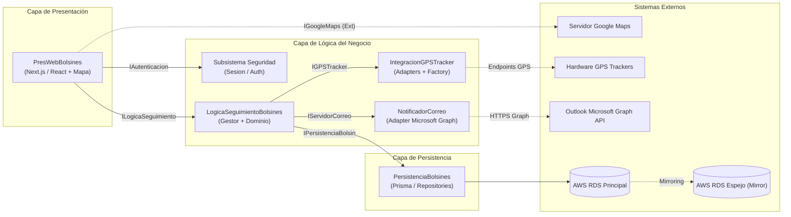

# Diseño Arquitectónico del PPAI Bolsines (Enfoque CU 36 + CU 30/31)

## 1. Vista Arquitectónica de Funcionalidad
El **CU 36: Consultar seguimiento de bolsines** (junto con su inclusión **CU 30/31: Notificar ubicación de bolsín**) es el caso de uso más significativo para la arquitectura del PPAI porque ejercita simultáneamente la mayor cantidad de Requerimientos No Funcionales críticos:
- **RNF 1**: Aplicación 100% Web.
- **RNF 2 & RNF 3**: Alta disponibilidad (7x24x365) mediante **Database Mirroring en Amazon AWS**.
- **RNF 4**: Seguridad y validación de sesión/rol y CM del empleado logueado.
- **RNF 5**: Integración externa con API de **Outlook de Microsoft Graph**.
- **RNF 6**: Integración polimórfica con dispositivos **GPS Tracker** (`XTR-4500L`, `NavTrack QX-7A`, `GeoPulse MTR-900`).
- **RNF 7**: Visualización cartográfica mediante API de **Google Maps**.

---

## 2. Vista de Componentes (Estilo Monolítico en Capas)

> **Criterio ISP en interfaces de notificación (Criterio de Cátedra):** En el diseño detallado de componentes y microservicios, las interfaces de notificación se segregan por **propósito de negocio** y no como una única interfaz genérica de envío de mails (ej. `INotificacionUbicacionBolsin` para CU 30/31 separada de `INotificacionRecepcionBolsin` para CU 29). Asimismo, el disparo de notificaciones desde el servicio Core hacia el servicio de Notificaciones es tráfico interno **Este-Oeste** (conexión directa socket-lollipop) sin volver a pasar por el API Gateway.

---

## 3. Vista de Diseño Global (Alternativa Microservicios DDD)
Si se modela bajo el estilo de **Microservicios** según `DSI CONVENCIONES DE MODELADO V1-5.pdf`:
- **Dominio Core**: `Servicio Bolsines` (armado, cierre, estado, seguimiento) + `Servicio Documentación y Remitos`.
- **Dominio de Soporte**: `Servicio Comisiones Médicas y Catálogos`.
- **Dominio Genérico**:
  - `Servicio Seguridad y Usuarios` (Auth / Sesiones).
  - `Servicio Rastreo GPS` (aloja los 3 Adapters `XTR-4500L`, `NavTrack QX-7A`, `GeoPulse MTR-900` para no contaminar el servicio Core con lógica de conversión).
  - `Servicio Notificaciones` (conexión a Outlook Microsoft Graph).
  - `Servicio Reportería` (integración con Power BI).
- **Gateways**: `API Gateway Pública` / `BFF Web` con interfaces requeridas hacia los servicios internos y externos.

---

## 4. Vista de Despliegue (AWS con Database Mirroring)
Conforme a **RNF 2** y **RNF 3**:
- **Nodo Cliente**: `Navegador Web (CMJ / CMC)` ejecutando el cliente web y librería de Google Maps.
- **Nodo Servidor Web / Aplicaciones (AWS EC2 / ECS)**: Aloja `PresWebBolsines`, Lógica de Negocio, Adapters GPS/Graph y Capa de Persistencia.
- **Nodo BD Principal (AWS RDS Primary)**: Base de datos PostgreSQL activa.
- **Nodo BD Espejo (AWS RDS Mirror - Otra AZ)**: Réplica síncrona conectada al Servidor de Aplicaciones para Failover transparente 7x24x365.
- **Nodos Externos**: `Servidor Google Maps`, `Dispositivos GPS Tracker`, `Servidor Microsoft Graph (Outlook)`.
