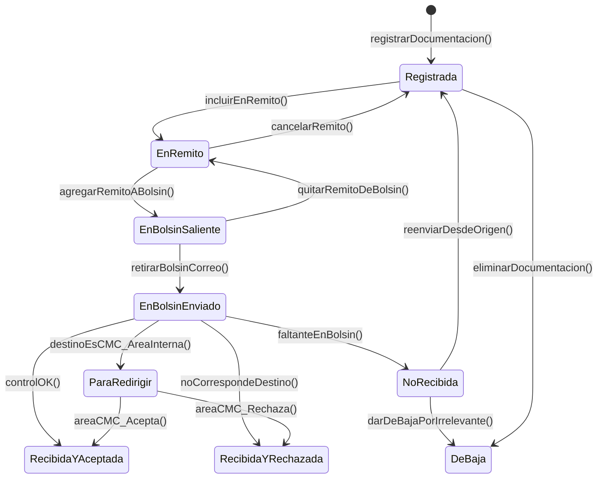

# Entidad del Dominio: Documentación

## 1. Atributos Principales
- `numero`: Número secuencial y único generado por el sistema al registrar la documentación.
- `tipoDocumento`: Referencia a `TipoDocumento` (ej. Expediente, Dictamen, Estudio Médico, Carta Documento).
- `fechaPase`: Fecha a partir de la cual la documentación debe ser enviada.
- `comisionMedicaOrigen`: CM que registra la documentación.
- `asunto`: Descripción relevante del contenido.
- `archivos`: Colección de 1 o más archivos adjuntos digitales (PDF, BMP, TIFF, JPEG, PNG, GIF, etc.).

---

## 2. Ciclo de Vida Completo (9 Estados)

1. **`Registrada`**: Estado inicial al darse de alta en la CM origen.
2. **`En remito`**: Al incorporarse en un remito hacia una CM destino. (Si el remito se cancela, vuelve a `Registrada`; si se quita de un bolsín, vuelve a `En remito`).
3. **`En bolsín saliente`**: Al incluirse el remito dentro de un bolsín en armado (`Creado`/`Cerrado`).
4. **`En bolsín enviado`**: Cuando el correo retira el bolsín de la CM origen.
5. **`Recibida y aceptada`**: Confirmada físicamente por el EB en destino o por el área interna de la CMC.
6. **`Recibida y rechazada`**: Llegó en un bolsín cuya CM destino no correspondía; debe devolverse a origen para reasociarse a un nuevo remito (o cuando no corresponde al área en CMC).
7. **`No recibida`**: Figuraba en el remito del bolsín pero no llegó físicamente en destino. Se notifica a origen para volver a `Registrada` (reenvío) o `De baja`.
8. **`Para redirigir`**: Caso especial cuando la CM destino es la **CMC (C.A.B.A.)** y la documentación debe derivarse internamente (sin bolsín) a un área de sede central.
9. **`De baja`**: Estado final cuando la documentación ya no es relevante para envío o se elimina antes de entrar a un remito.

