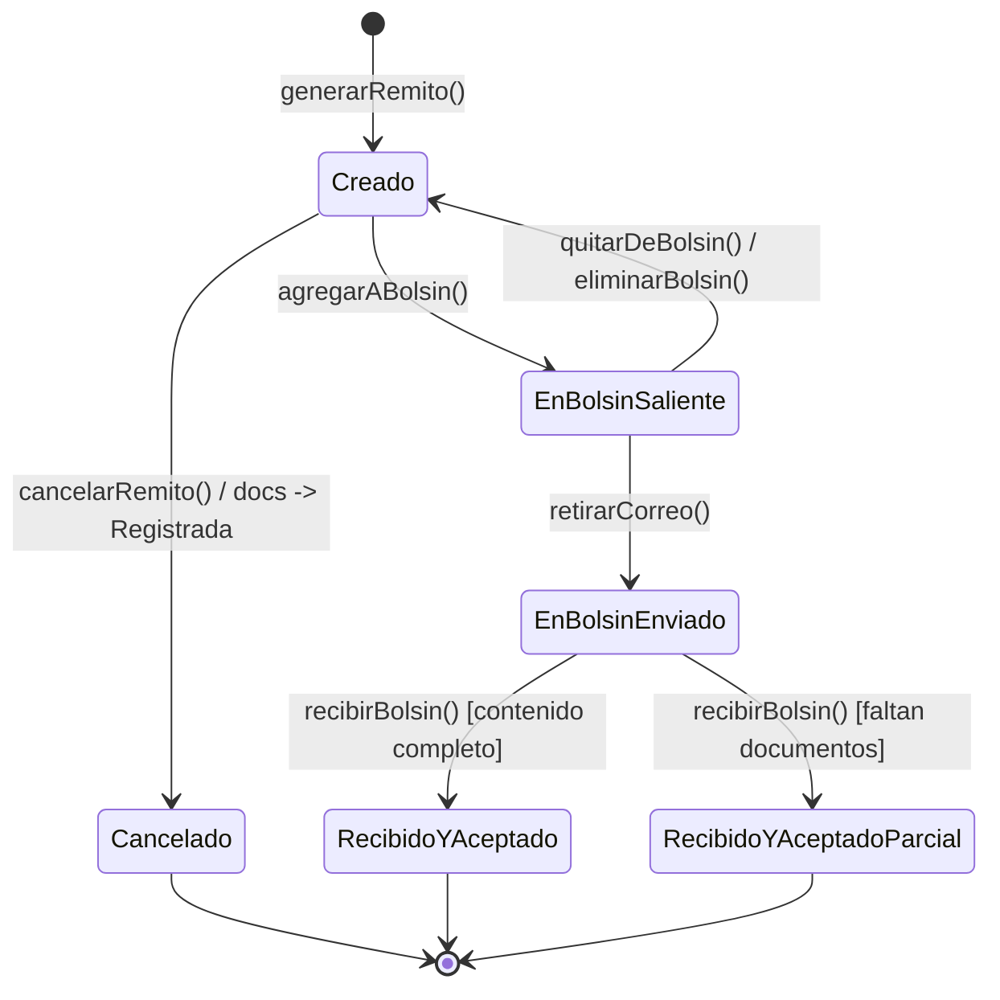

# Entidad del Dominio: Remito

## 1. Definición Conceptual
El **Remito** es el comprobante formal que acompaña físicamente dentro del bolsín a la documentación enviada, detallando qué expedientes, dictámenes o estudios se remiten hacia una Comisión Médica Destino específica.

## 2. Reglas de Negocio Clave (ERS Sección 2.2)
1. **Un Remito por cada CM Destino**: Si se desea enviar documentación a tres CM distintas (ej. Tucumán, Rosario y La Plata), el sistema debe generar **3 remitos distintos** e incluirlos en **bolsines diferentes**.
2. **Múltiples Remitos por Bolsín**: Un bolsín dirigido a una única CM Destino puede agrupar **uno o más remitos** generados en distintos momentos.
3. **Modificación por Remitos Completos**: Si se modifica un bolsín quitando contenido, debe quitarse **un remito completo** junto con toda su documentación asociada. Si el bolsín tenía un único remito, puede cancelarse ese remito y crearse uno nuevo.
4. **Cancelación de Remito**: Solo puede cancelarse mientras está en estado `Creado` (sin haberse incluido en un bolsín). Al cancelarse, toda su documentación vuelve al estado `Registrada`.

---

## 3. Máquina de Estados del Remito

## 4. Impacto en el CU 36 (Seguimiento)
Cuando el Encargado de Bolsines selecciona un bolsín en el mapa o notifica su ubicación al GCM destino (**CU 30/31** y **RNF 5**), el detalle enviado incluye los remitos contenidos en el bolsín junto con el listado completo de su documentación asociada (asunto y tipo de documento).
